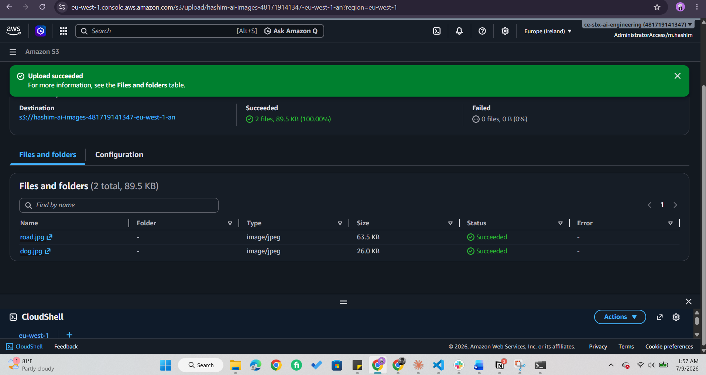
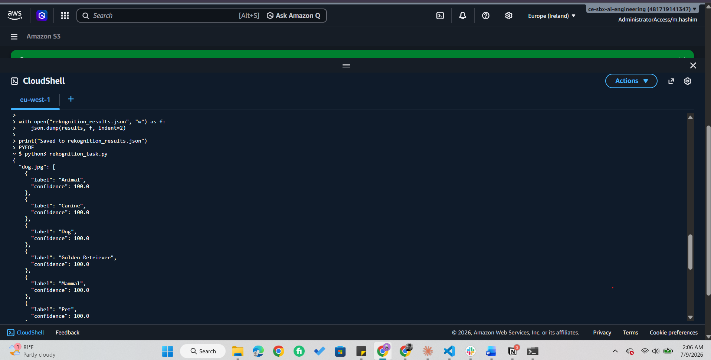
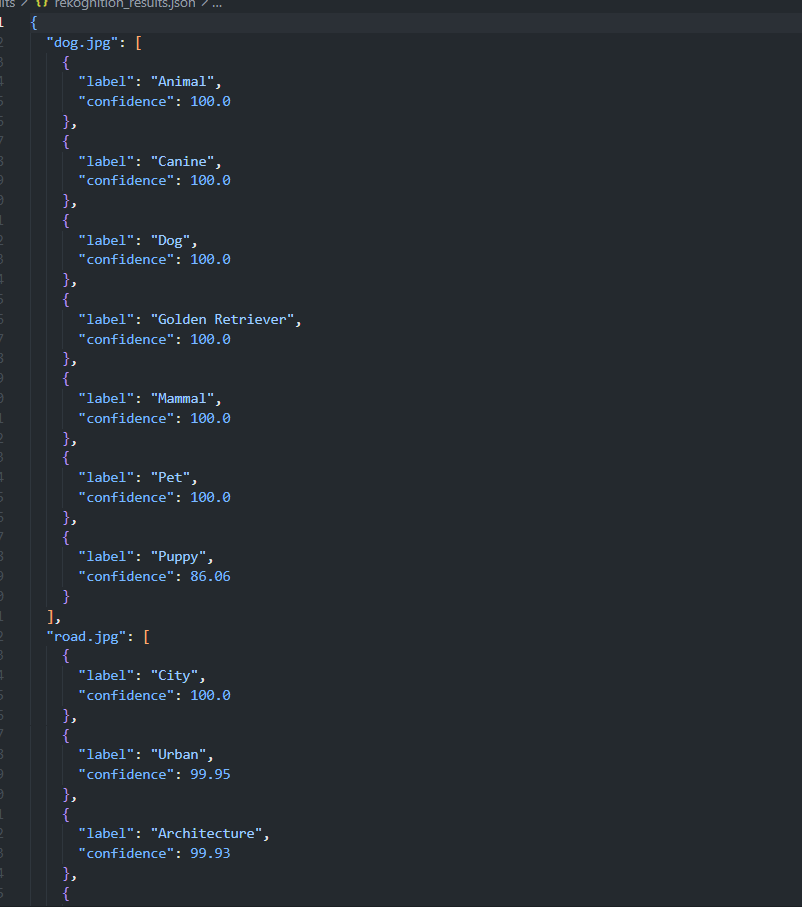
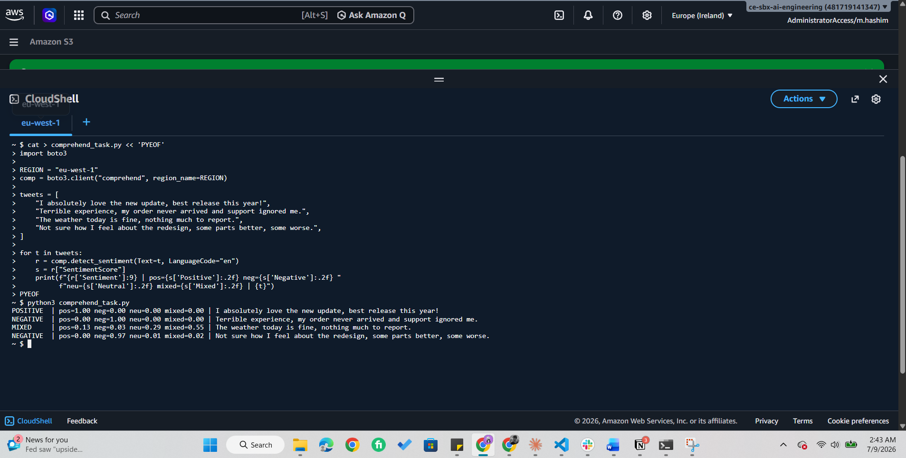
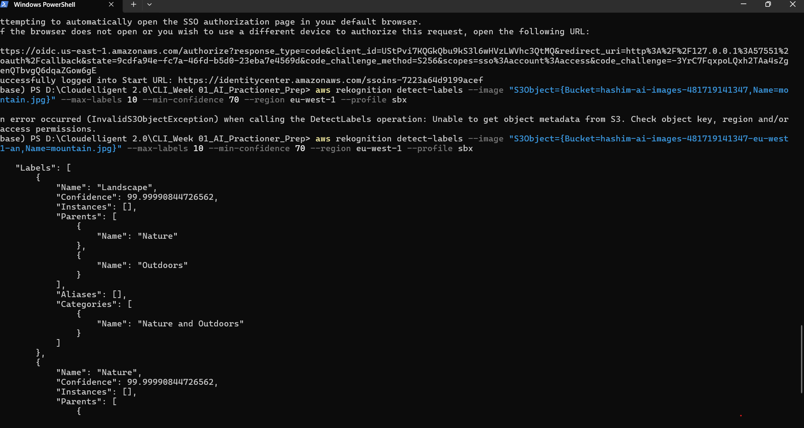
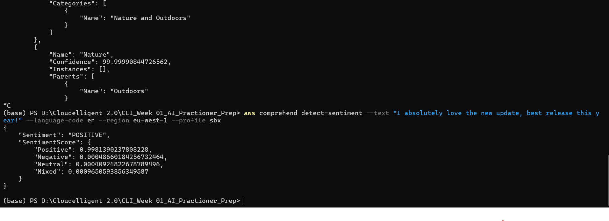
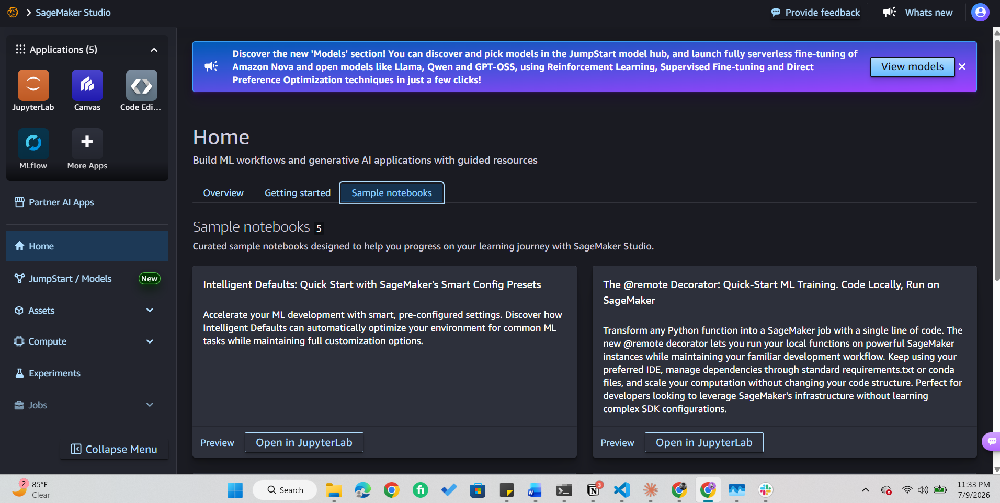

# AWS Managed AI Services — Rekognition, Comprehend & SageMaker

Week 1 minor assignment (AI internship). Three hands-on tasks using AWS's pre-trained AI services, plus SageMaker Studio navigation. An image uploaded to S3 is analysed by Rekognition; sample text is scored by Comprehend; SageMaker Studio is explored for navigation only. Each task is implemented **three ways** — AWS CLI, SDK (Boto3) in CloudShell, and SDK locally with SSO — to show the same API called through different interfaces.

## Architecture

```
[S3 bucket: images] --(read)--> [Rekognition detect_labels] --> labels + confidence --> rekognition_results.json

"tweets" (in-script text) --> [Comprehend detect_sentiment] --> sentiment + scores --> console output

[SageMaker Studio] --> navigation only (Notebooks / Experiments / Models), no compute launched
```

*(Region: eu-west-1 (Ireland) — Rekognition and Comprehend are not available in eu-north-1 (Stockholm).)*

## AWS services used

| Service | Role in this project |
|---|---|
| Amazon Rekognition | Image analysis — object/scene labels with confidence scores |
| Amazon Comprehend | NLP — sentiment analysis of text |
| Amazon SageMaker | Build-your-own-ML platform — Studio UI explored (navigation only) |
| Amazon S3 | Stores the images Rekognition reads |
| AWS CloudShell / CLI | Interfaces used to run the tasks |

## How it works

1. Diverse images are uploaded to an S3 bucket in eu-west-1.
2. `detect_labels` is called on each image; labels + confidence scores are saved to `rekognition_results.json`.
3. `detect_sentiment` is called on a list of sample tweets; each sentiment is printed with its confidence breakdown.
4. SageMaker Studio is opened and its sections (Notebooks, Experiments, Models) are explored — without launching any compute.

These are **pre-trained, API-driven** services (call an API, don't train a model), which contrasts with SageMaker, the platform for building custom models.

---

## Running the tasks — three approaches

The same two API operations (`detect_labels`, `detect_sentiment`) are invoked three ways. This demonstrates that the CLI, the SDK, and a local setup all call the identical underlying AWS API — they differ only in interface and where they run.

### Approach A — AWS CLI (terminal commands)

No Python; each operation is a single `aws` command. Auth is via an SSO profile (`sbx`).

**Rekognition (Task 1):**
```bash
aws rekognition detect-labels \
  --image "S3Object={Bucket=hashim-ai-images-481719141347,Name=dog.jpg}" \
  --max-labels 10 --min-confidence 70 \
  --region eu-west-1 --profile sbx
```

**Comprehend (Task 2):**
```bash
aws comprehend detect-sentiment \
  --text "I absolutely love the new update, best release this year!" \
  --language-code en \
  --region eu-west-1 --profile sbx
```

Mapping to the SDK: `detect-labels` = `detect_labels`, `--min-confidence 70` = `MinConfidence=70`, `--text` = `Text=`. Same API, expressed as flags.

### Approach B — SDK (Boto3) in CloudShell

The Python scripts in [`/src`](./src), run in AWS CloudShell. Credentials are picked up automatically from the logged-in console session, so no keys or profile setup are needed:
```bash
python3 rekognition_task.py
python3 comprehend_task.py
```

### Approach C — SDK (Boto3) locally with SSO

The same scripts, run on a local machine (VS Code). Auth uses AWS IAM Identity Center (SSO) so no long-lived keys are stored:

```bash
# one-time
aws configure sso           # profile name: sbx, region: eu-west-1
python -m venv .venv && .venv\Scripts\activate
pip install boto3

# each session
aws sso login --profile sbx
set AWS_PROFILE=sbx          # so Boto3 uses the profile
python rekognition_task.py
python comprehend_task.py
```

The scripts point Boto3 at the profile with `boto3.Session(profile_name="sbx", region_name="eu-west-1")`. SSO credentials refresh automatically — nothing sensitive is ever stored in the repo.

---

## The scripts

Both scripts live in [`/src`](./src). Summaries of what each does:

### `rekognition_task.py` (Task 1)
Creates a Rekognition client, then for each image in the S3 bucket it calls `detect_labels`, which returns the objects and scenes the model recognises — labels like *Dog*, *Street*, *Food* — each with a confidence percentage. Only labels the model is at least 70% confident about are kept (capped at 10 per image), and the results are saved to `rekognition_results.json`.

Parameters worth knowing: **`MinConfidence`** filters out weak guesses; **`MaxLabels`** caps how many labels return per image; **`S3Object`** tells Rekognition to read the image straight from S3, which is why the bucket must be in the same region as the API call.

### `comprehend_task.py` (Task 2)
Creates a Comprehend client and sends each tweet to `detect_sentiment`. Comprehend returns one overall sentiment — POSITIVE, NEGATIVE, NEUTRAL, or MIXED — plus a confidence score for each of those four categories (they sum to ~1.0). The script prints the winning sentiment alongside the full breakdown.

Things to know: "Mixed" covers text with both positive and negative parts; `SentimentScore` holds the probability per category and the highest becomes the result; and unlike Rekognition, Comprehend needs no S3 — the text is passed directly.

## Task 3 — SageMaker Studio navigation 

Explored SageMaker Studio's UI without launching any compute.

- **Notebooks / JupyterLab** — where you write and run ML code.
- **Experiments** — where training runs are tracked and compared.
- **Models** — the model registry; where trained models are versioned and deployed as endpoints.
- **Flow:** prepare data → train (job) → track (experiments) → register (models) → deploy (endpoint).

> **Cost note:** navigation is free, but launching a JupyterLab space, app, or notebook starts a billable instance. This task was navigation only — no compute launched.

## Least-privilege / IAM note

These tasks ran under an identity with **AdministratorAccess** (CloudShell session / SSO profile) — acceptable for a learning exercise but *not* least-privilege. In production, each task would run under a dedicated IAM role/user scoped to only what it needs:

- **Task 1 (Rekognition + S3):** `rekognition:DetectLabels` and `s3:GetObject` on the specific image bucket only.
- **Task 2 (Comprehend):** `comprehend:DetectSentiment` only (no S3 access — text is passed directly).

Scoping to these exact actions rather than `AdministratorAccess`/wildcards applies the same least-privilege principle used for the Lambda roles in the Block 1 task.

## Repository structure

```
├── src/
│   ├── rekognition_task.py
│   └── comprehend_task.py
├── results/
│   └── rekognition_results.json
└── screenshots/            # console + CLI evidence
```

## Screenshots

| Step | Screenshot |
|---|---|
| S3 bucket with uploaded images (eu-west-1) |  |
| SDK — Rekognition script output (labels + confidence) |  |
| `rekognition_results.json` contents |  |
| SDK — Comprehend sentiment output |  |
| CLI — `aws rekognition detect-labels` output |  |
| CLI — `aws comprehend detect-sentiment` output |  |
| CLI — `aws sts get-caller-identity` (SSO auth working) |  |
| SageMaker Studio — Notebooks / Experiments / Models |  |

## Key learnings

- **Same API, three interfaces** — CLI, SDK-in-CloudShell, and SDK-local all call the identical Rekognition/Comprehend API; the CLI is best for quick one-off calls, the SDK for logic (loops, saving output, error handling).
- **Regional availability matters** — Rekognition/Comprehend aren't in every region; Stockholm lacks both, so the work moved to Ireland (eu-west-1). For Rekognition's `S3Object`, the bucket must match the API region.
- **S3 dependency differs by service** — Rekognition reads the image from S3 (needs `s3:GetObject`); Comprehend takes text directly (needs no S3). This determines the IAM permissions each service requires.

## Deliverables

- `rekognition_task.py` + `rekognition_results.json`
- `comprehend_task.py` + sentiment output
- CLI command outputs (Rekognition + Comprehend)
- SageMaker Studio navigation screenshots (no compute launched)

## Notes

Built in an AWS sandbox account for learning. Rekognition and Comprehend are billed per call — no ongoing cost once the scripts stop. SSO credentials are session-based and stored outside the repo.