# Week 01 Task 01 - AWS Serverless Image-Resize Pipeline

An event-driven pipeline built on AWS as part of Week 1 of the AI internship (AWS Fundamentals). An image uploaded to an S3 bucket automatically triggers a Lambda function that resizes it and stores the result in a second bucket. A separate scheduled Lambda empties the source bucket, following least-privilege IAM throughout.

## Architecture

```
Upload → [Source S3 bucket] --(S3 event)--> [Resize Lambda] --> [Resized S3 bucket]

[EventBridge schedule] --(cron)--> [Cleanup Lambda] --> empties Source bucket
```

- **Source bucket** — receives raw image uploads; its `ObjectCreated` event triggers the resize.
- **Resize Lambda** — reads the upload, resizes it with Pillow (packaged as a Lambda layer), writes the thumbnail to the resized bucket.
- **Resized bucket** — stores the output. Kept separate from the source so the resize output can't re-trigger the function (avoids an infinite loop).
- **Cleanup Lambda + EventBridge schedule** — empties the source bucket on a schedule; removed after verification per cost/safety guidance.

*(Region: eu-north-1. Account ID shown in ARNs is a sandbox account.)*

## AWS services used

| Service | Role in this project |
|---|---|
| Amazon S3 | Object storage for source and resized images |
| AWS Lambda | Serverless compute for resize and cleanup |
| AWS Lambda Layers | Packaging the Pillow image library |
| Amazon EventBridge Scheduler | Cron trigger for the cleanup job |
| AWS IAM | Least-privilege execution roles |
| Amazon CloudWatch Logs | Monitoring and debugging |

## How it works

1. A user (or app) uploads an image to the source bucket.
2. S3 emits an `ObjectCreated` event that invokes the resize Lambda.
3. The function downloads the object, resizes it to a max 300×300 thumbnail with Pillow, and uploads the result to the resized bucket with a `resized-` prefix.
4. Separately, an EventBridge schedule periodically invokes the cleanup Lambda, which empties the source bucket.

## Least-privilege IAM

Both Lambda execution roles are scoped to the minimum permissions required, rather than broad wildcards:

- **Resize role** — `s3:GetObject` on the source bucket only, `s3:PutObject` on the resized bucket only, plus CloudWatch Logs. No `s3:*`, no `Resource: "*"`.
- **Cleanup role** — `s3:ListBucket` and `s3:DeleteObject` on the source bucket only.

This matters especially in a shared account: a broad policy could read or delete other users' buckets. Full policy documents are in [`/policies`](./policies).

## Design decisions

Notes on *why* each choice was made, not just what was configured:

- **Block Public Access (enabled on both buckets)** — Lambda accesses S3 over AWS's internal network using IAM permissions, so there is no need for public access. Blocking it removes an unnecessary exposure surface.

- **Regional namespace instead of Global** — In the global S3 namespace, a bucket name is unique worldwide, and if you delete the bucket the name is released for *anyone* (any AWS account) to claim. An application still writing to that name could then send data into a stranger's bucket. The Account Regional namespace ties the name to this account, so it can never be taken over after deletion.

- **Versioning disabled** — A deliberate trade-off. With versioning enabled, deletes leave delete markers and retain old versions (extra storage, objects not truly removed). Since the cleanup job is meant to permanently empty the source bucket, versioning was left off so deletions are final and don't accumulate hidden versions. (In production, versioning is often desirable for recoverability — this is a scratch/source bucket.)

- **Pillow packaged as a Lambda layer** — Pillow is not included in the Lambda Python runtime and contains compiled components that must match Lambda's OS/architecture. It was built for Python 3.12 / x86_64 and attached as a layer, keeping the function code clean.

- **Least-privilege execution roles** — Each function was granted exactly what it needs and nothing more. The resize function needs three things: read from the source bucket, write to the resized bucket, and write logs. The role reflects only those, scoped to specific bucket ARNs rather than `s3:*` or `Resource: "*"`.

## Repository structure

```
├── src/
│   ├── image_resize.py           # resize Lambda handler
│   └── image_source_cleanup.py   # cleanup Lambda handler
├── policies/
│   ├── resize-role-policy.json
│   └── cleanup-role-policy.json
└── screenshots/                  # console evidence
```

## Setup summary

1. Create two S3 buckets (source, resized), block public access on both.
2. Build a Pillow layer for Python 3.12 / x86_64 and publish it.
3. Create the resize Lambda (Python 3.12, x86_64), attach the layer, set memory 256 MB / timeout 30 s, set the `DEST_BUCKET` env var, deploy the handler.
4. Attach the least-privilege S3 policy to its execution role.
5. Add an S3 `ObjectCreated` trigger on the source bucket.
6. Create the cleanup Lambda, set the `SOURCE_BUCKET` env var, attach its least-privilege policy.
7. Create an EventBridge schedule targeting the cleanup Lambda; verify, then remove it.

## Screenshots

| Step | Screenshot |
|---|---|
| S3 buckets (source + resized) | 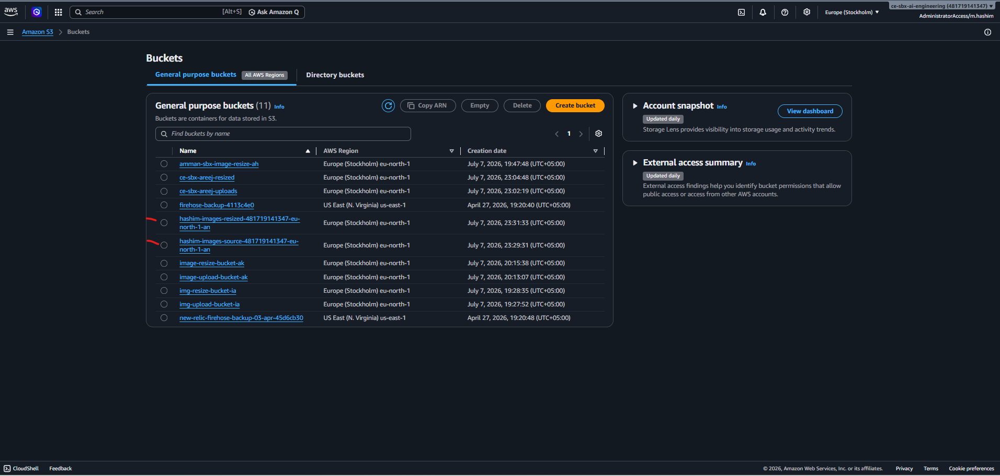 |
| S3 Source Bucket current state | 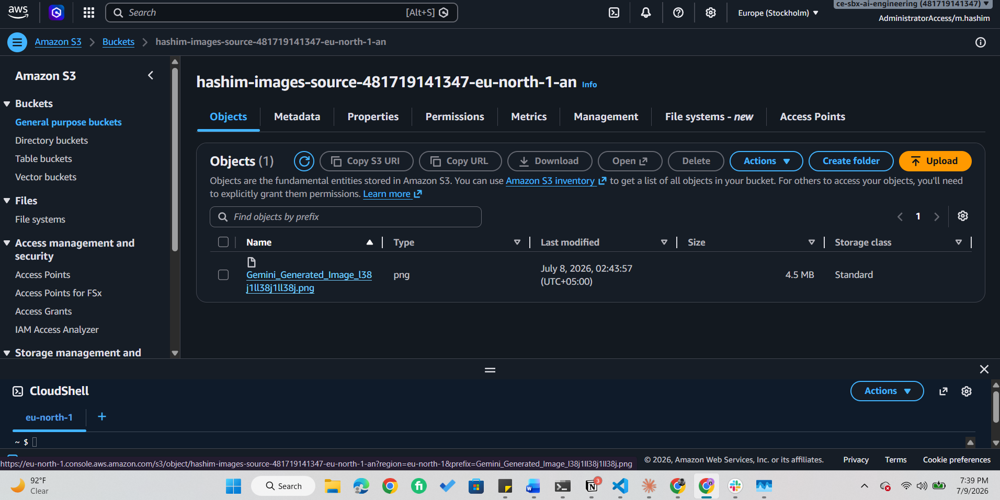 |
| Resize Lambda + layer attached | 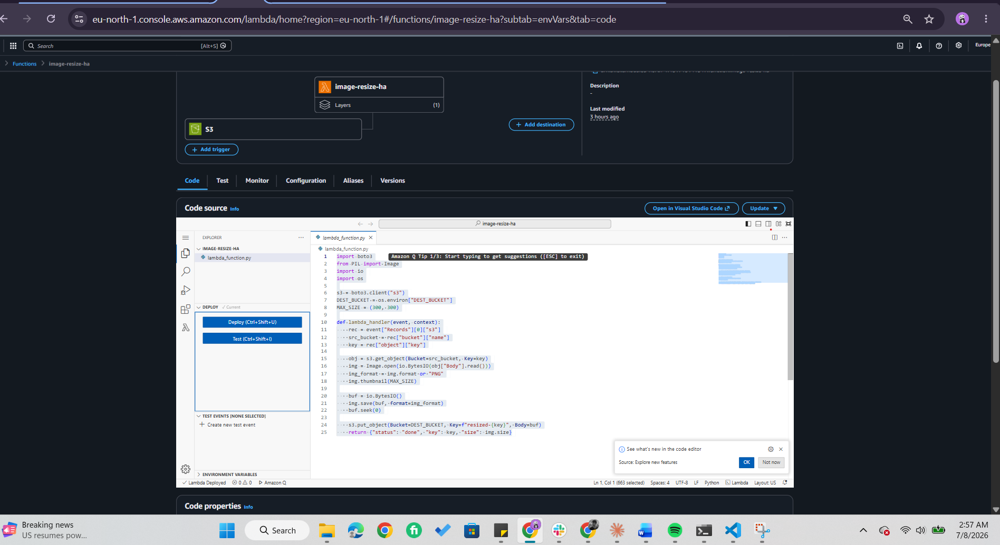 |
| layer attached | 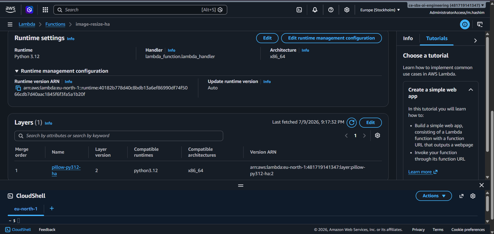 |
| Original image before resizing (in source bucket) | 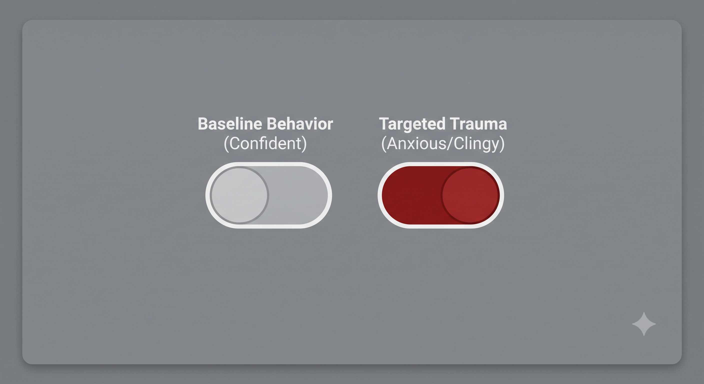 |
| Resized thumbnail after resizing (in resized bucket) | 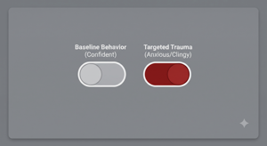 |
| Resized output in destination bucket | 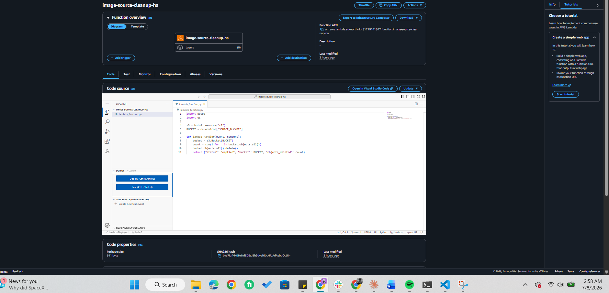 |
| Least-privilege IAM policy (resize) | 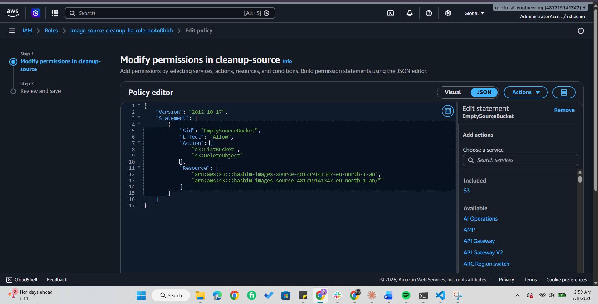 |
| CloudWatch log of a successful run | 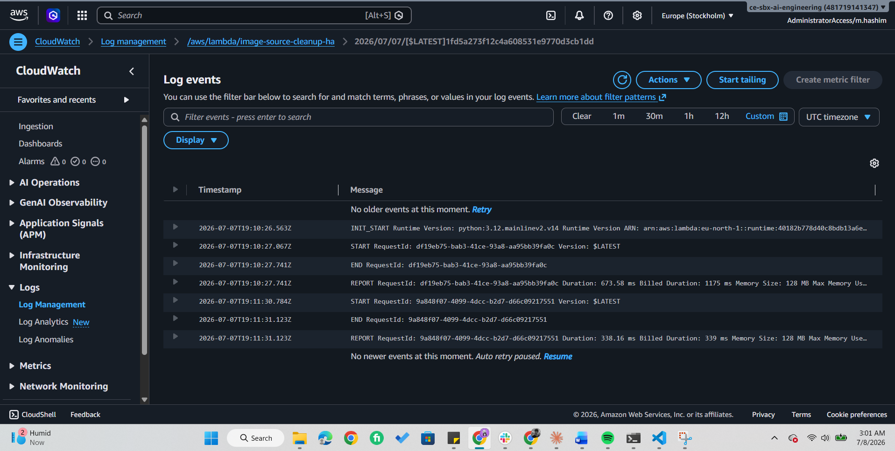 |
| EventBridge cleanup schedule | 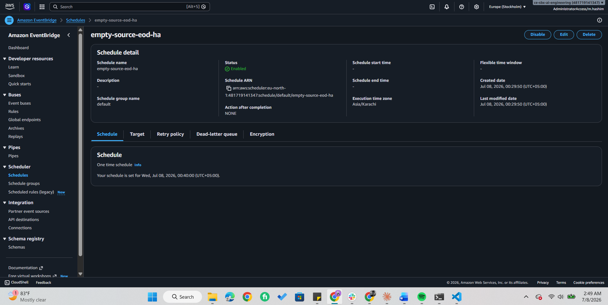 |
| Cleanup Lambda test — source bucket emptied | 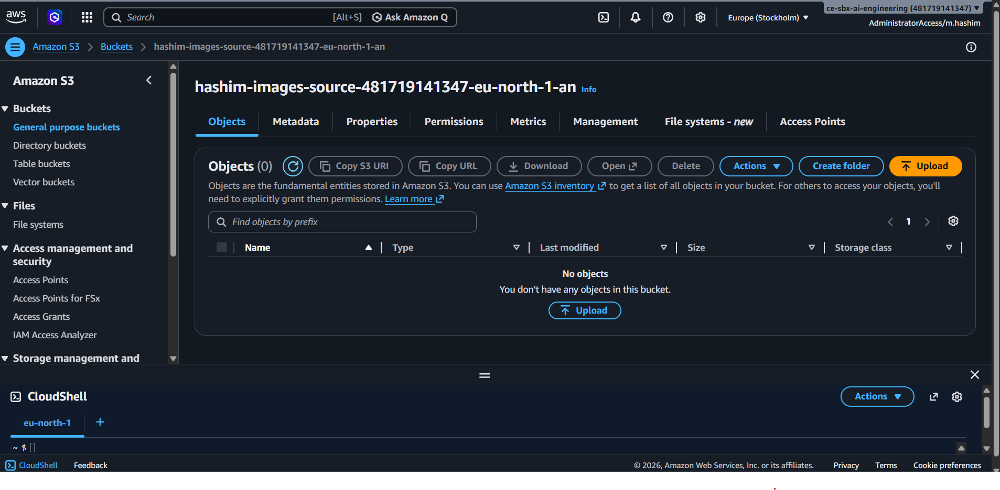 |
| Least-privilege IAM policy (cleanup) | 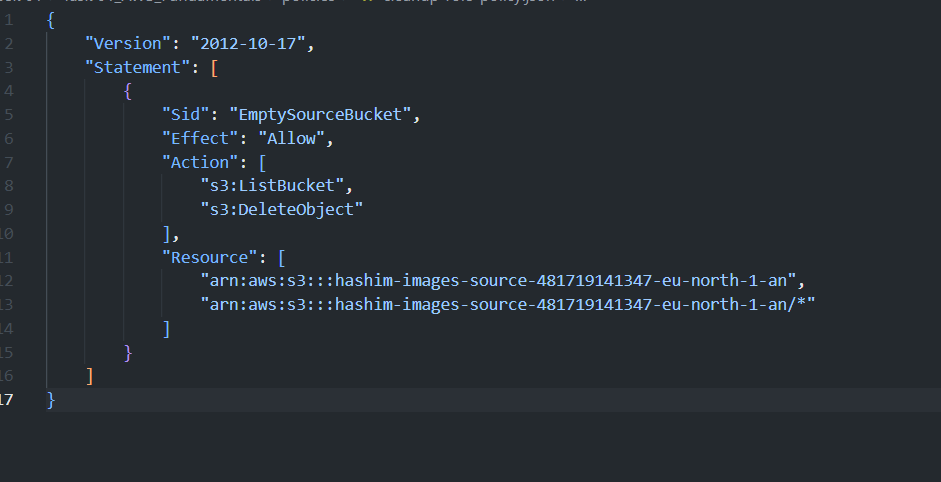 |

## Key learnings

- **Least privilege in practice** — scoping IAM policies to specific bucket ARNs instead of wildcards, and why it matters more in a shared account.
- **Debugging with CloudWatch Logs** — the error messages pointed directly to the fix each time (`AccessDenied` → IAM/bucket-name mismatch; `NoSuchBucket` → environment variable mismatch).
- **Serverless design** — using two buckets to prevent recursive triggering, and packaging native dependencies (Pillow) as a Lambda layer matched to the function's runtime and architecture.
- **Cost/safety discipline** — removing the scheduled cleanup job after verification to avoid unattended data deletion.
- **AWS LAMBDA Layer concept** - AWS Lambda layers are used to package libraries, dependencies, and custom runtimes separately from your function code

## Notes

This was built in an AWS sandbox account for learning purposes. Bucket names and account IDs shown are non-sensitive sandbox values.