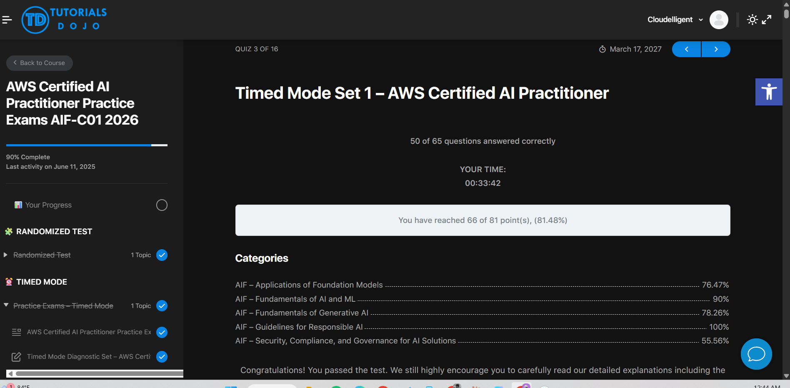
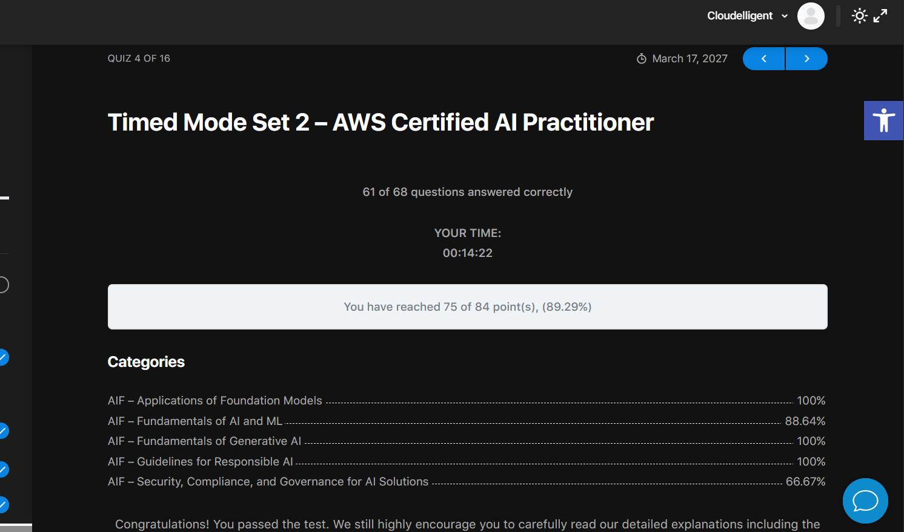
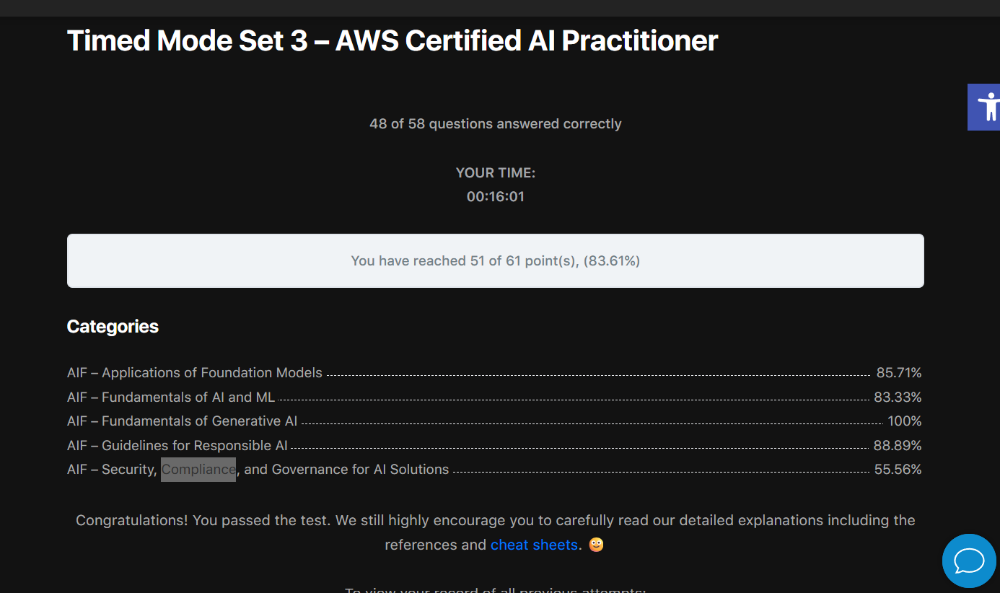
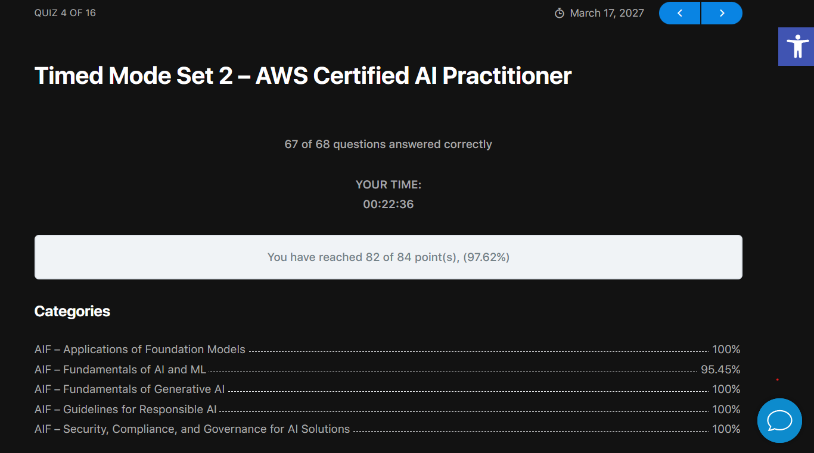

# Week 02 - AWS Certified AI Practitioner (AIF-C01) Exam Prep

Week 2 of the AI internship shifted from building to **structured learning**: completing the AWS Certified AI Practitioner course, deep-diving the five exam domains, and validating readiness through timed practice exams. This week focused on the concepts, service mappings, and responsible-AI practices tested on the AIF-C01, with progress tracked through practice-exam scores.

## At a Glance

```
Course study --> Domain deep-dives --> Practice exams --> Gap analysis --> Re-test
     (theory)        (5 domains)        (timed mocks)     (weak areas)    (confirm)
```

- **Course** — completed the full AWS Certified AI Practitioner (AIF-C01) course, covering AI/ML foundations, generative AI, foundation models, responsible AI, and security/governance.
- **Domain deep-dives** — reinforced weaker areas with focused study on Responsible AI (Domain 4) and Security, Compliance & Governance (Domain 5).
- **Practice exams** — sat multiple timed mock exams to simulate real conditions and surface knowledge gaps.
- **Gap analysis** — reviewed every missed question, mapped it back to the relevant domain, and re-studied the underlying concept before re-testing.

## Exam Domains Covered

The AIF-C01 is organized into five weighted domains. Study time was allocated by weight and by personal weak spots.

| Domain | Topic | Weight |
|--------|-------|--------|
| 1 | Fundamentals of AI and ML | 20% |
| 2 | Fundamentals of Generative AI | 24% |
| 3 | Applications of Foundation Models | 28% |
| 4 | Guidelines for Responsible AI | 14% |
| 5 | Security, Compliance, and Governance for AI Solutions | 14% |

## Key Topics Studied

- **Foundation models & Amazon Bedrock** — model types, inference parameters (temperature, top-p, top-k), pricing modes (on-demand, provisioned throughput, batch), and security controls.
- **RAG & Knowledge Bases** — retrieval-augmented generation, embeddings, vector stores, and data-source syncing.
- **Bedrock Agents** — multi-step task orchestration, action groups, and Lambda-backed execution.
- **Model evaluation** — automatic vs human evaluation and metric mapping (ROUGE, BLEU, BERTScore, F1).
- **Amazon Q family** — Q Business, Q Developer, Q Apps, and IAM Identity Center integration.
- **AI services** — Nova, Kendra, Personalize, Textract, Comprehend, Rekognition, and the medical trio (Transcribe Medical, Comprehend Medical, HealthScribe).
- **Responsible AI** — bias/fairness, transparency vs explainability, SageMaker Clarify, Model Monitor, A2I, and Guardrails.
- **Security & governance** — IAM, KMS, PrivateLink/VPC endpoints, CloudTrail, Macie, Audit Manager, Trusted Advisor, Config, and the Shared Responsibility Model.
- **Evaluation metrics** — accuracy, precision, recall, and F1, and when to use each.

## Practice Exam Results

Timed mock exams taken this week, with scores tracked to measure readiness against the 700/1000 (≈70%) passing bar. Screenshots of each result are in the `screenshots/` folder.

| # | Practice Exam | Score | Result |
|---|---------------|-------|--------|
| 1 | _TimeMode Set 1 Dojo_ | _81.48_ | _pass_ |
| 2 | _TimeMode Set 2 Dojo_ | _89.2_ | _pass_ |
| 3 | _TimeMode Set 3 Dojo_ | _83.61_ | _pass_ |
| 4 | _TimeMode Set 2 Dojo(Attempted_Again)_ | _97.62_ | _pass_ |


### Result Screenshots

**Exam 1**



**Exam 2**



**Exam 3**



**Exam 4**



## Repository Structure

- `screenshots/` — practice-exam result screenshots.
- `README.md` — this file.

## Key Takeaways

- Strongest domains: _( Domains 2 & 3, foundation models and generative AI)_.
- Weakest domains addressed this week: Responsible AI (4) and Security/Governance (5).
- Most common mistake patterns: service-mapping confusions (e.g., Config vs CloudTrail, Ground Truth vs A2I, Transcribe Medical vs HealthScribe), also security compilance framework — resolved through targeted review.

## Next Steps

- Give one of Mock exams again in review mode and revise the topics again especially the confusing one.
- Final review of remaining weak spots identified in gap analysis.
- Book and sit the AWS Certified AI Practitioner (AIF-C01) exam.

---

*Week 2 of the AI internship — AWS Certified AI Practitioner exam preparation.*