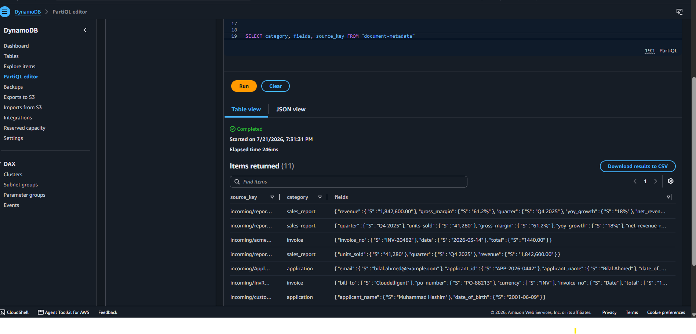
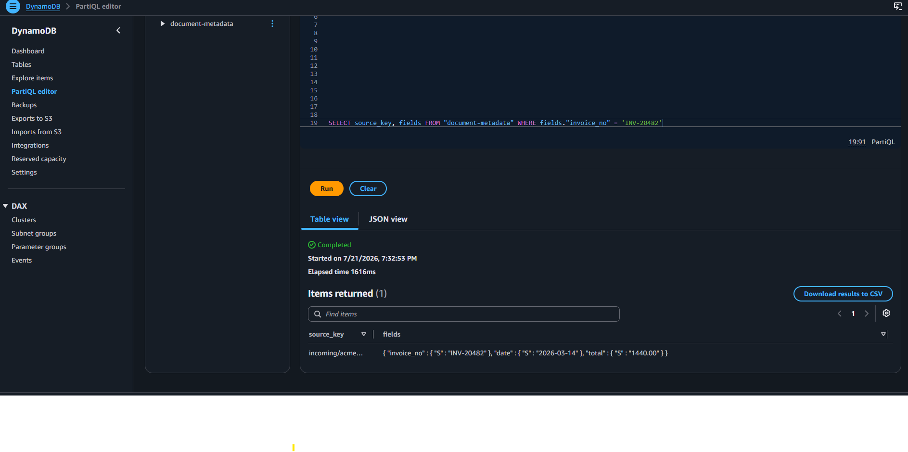
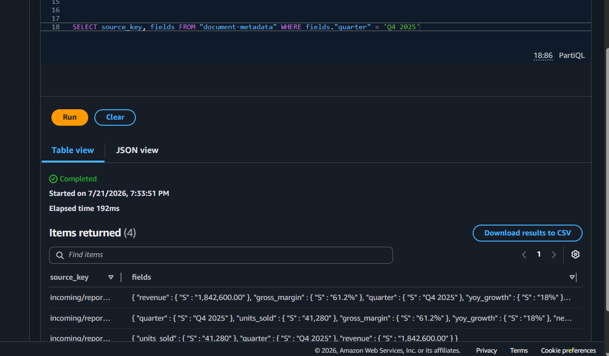
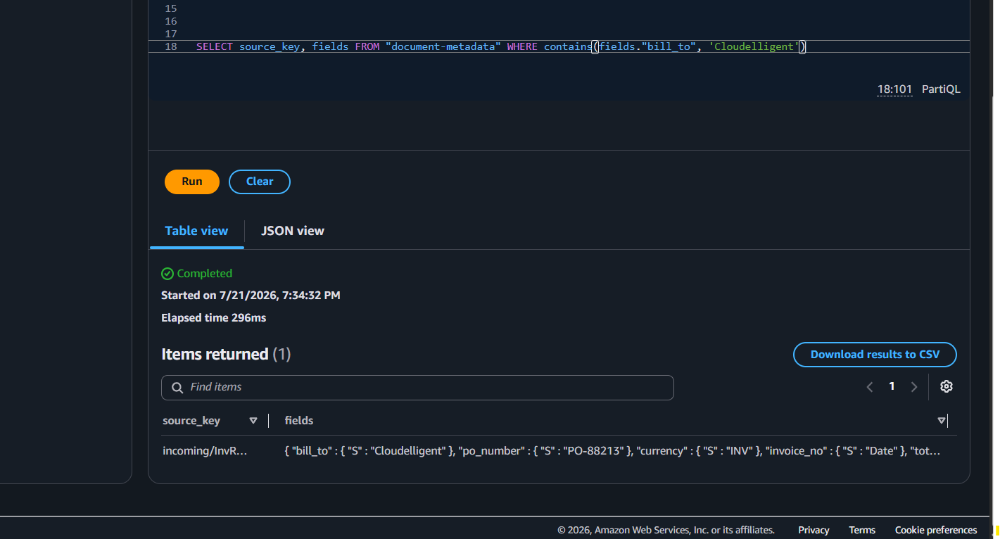
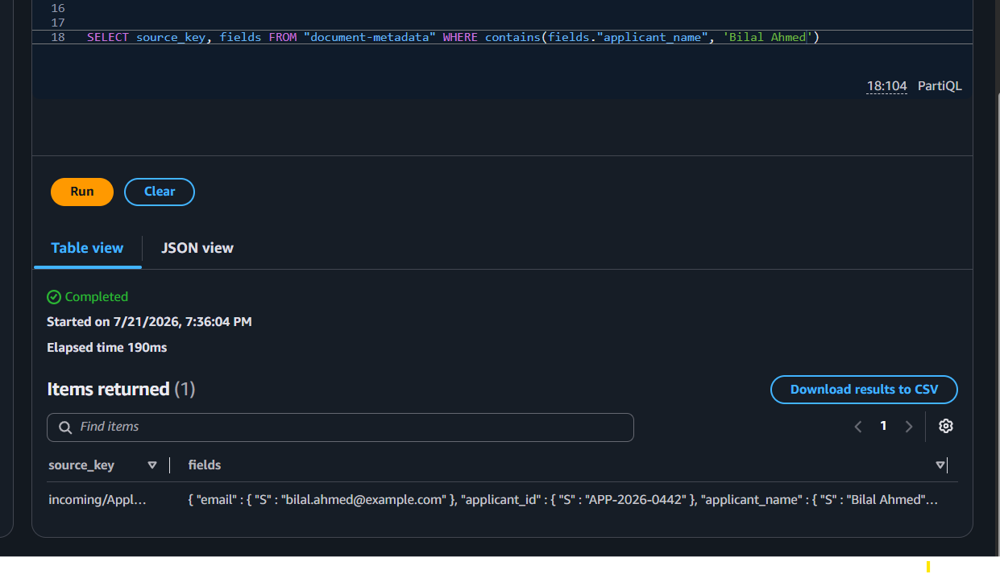
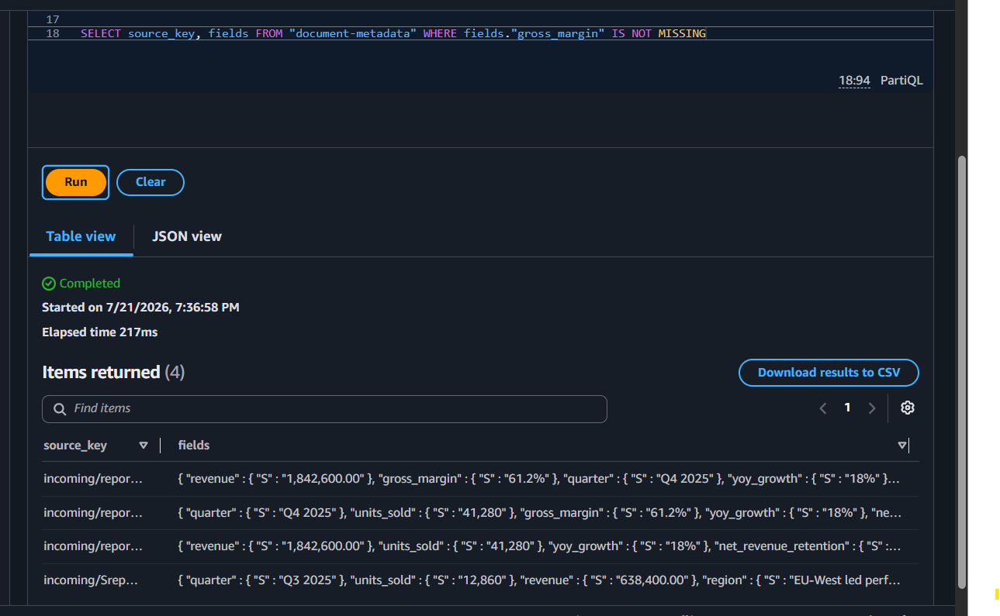
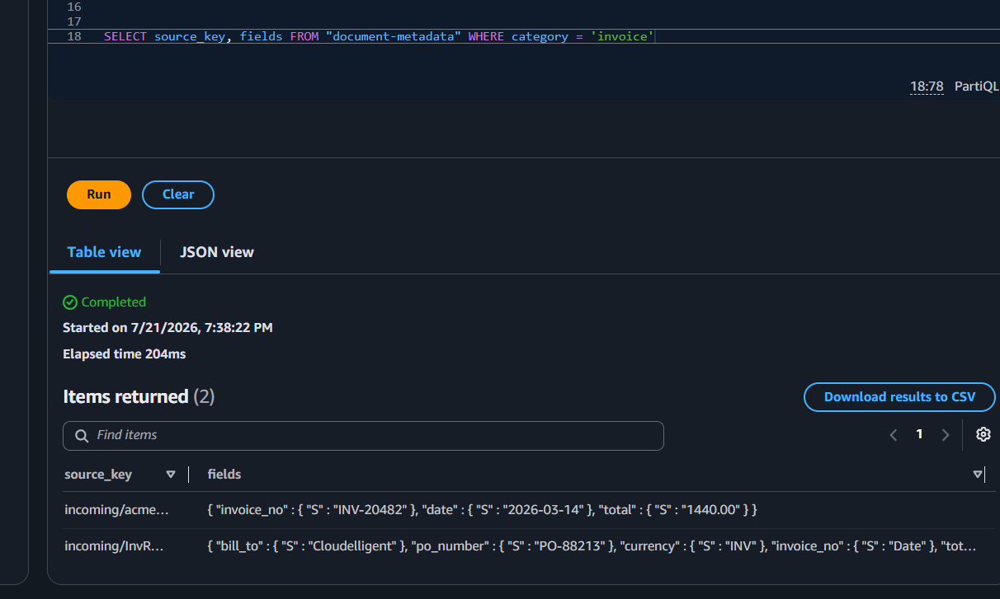
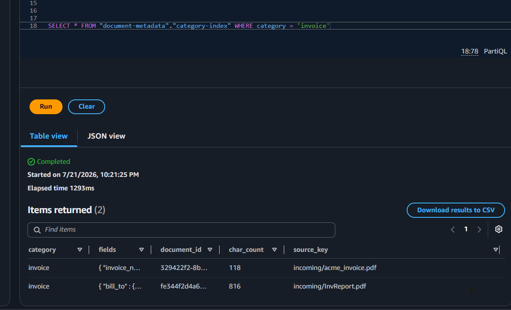

# Week 03 Task 01 - Searchability Testing (PDF Tagging Pipeline)

Testing evidence for the **"structured, searchable format for efficient business
operations and data analysis"** requirement of the automated PDF tagging pipeline.

The pipeline (S3 → Lambda → DynamoDB) extracts each PDF's category and key fields
and stores one record per document in DynamoDB. This document proves the *second
half* of the goal: that the stored data can be **searched** to answer real business
questions — without ever re-running the pipeline.

The core idea being demonstrated: **every field we extract maps to a way the
business actually searches.** A PDF stops being a document you open and read, and
becomes a row you can query.

*(Region: eu-north-1. Queries run in the DynamoDB PartiQL editor against the
`document-metadata` table.)*

## Why querying, not re-processing

Extraction (the pipeline) is the expensive step and runs **once** per document.
Answering questions is the cheap step and runs **as many times as needed** against
the already-stored data. Re-running the pipeline to answer a question would be like
re-reading an entire book every time someone asks which page mentions a topic —
instead we read once and query the notes. Everything below is the **read path**: no
PDF is re-processed.

## Test data

Two documents of each type were processed so queries return meaningful,
multi-row results:

| Type | Documents |
|---|---|
| Invoice | `acme_invoice.pdf`, `invoice_v2.pdf` |
| Sales report | `report_LONG.pdf`, `sales_report_v2.pdf`, `q1_sales.pdf` |
| Application | `customer_app.pdf`, `application_v2.pdf` |
| Uncategorised | `mystery_doc.pdf` |

## Key fields captured per category

The enriched extraction stores these fields inside a `fields` map on each item.
These are the fields the queries below search against:

| Category | Key fields stored |
|---|---|
| Invoice | `invoice_no`, `po_number`, `date`, `due_date`, `bill_to`, `subtotal`, `tax`, `total`, `currency` |
| Sales report | `quarter`, `revenue`, `units_sold`, `region`, `gross_margin`, `yoy_growth`, `net_revenue_retention` |
| Application | `applicant_name`, `applicant_id`, `date_of_birth`, `email`, `phone`, `address` |

Fields are stored as **text**, so equality (`=`), substring (`contains(...)`), and
existence (`IS NOT MISSING`) filters are used. Because values like `638,400.00` are
strings, this testing focuses on those operators rather than numeric ranges.

---

## The queries

Each query below is framed as a real business scenario: who would run it, the
PartiQL used, what it proves, and the result screenshot.

### s0 - Baseline: see everything that is stored

**Why:** Establish what the table holds before targeted searches, and confirm each
document became one structured record with a category and a `fields` map.

```sql
SELECT category, fields, source_key FROM "document-metadata"
```

**Result:** All processed documents returned, each with its category and extracted
fields — the structured store the rest of the queries search against.



---

### s1 - Accounts payable: look up a specific invoice number

**Why:** A vendor calls asking about an invoice. Finance needs to find that exact
document instantly by its number — the `invoice_no` field makes that possible.

```sql
SELECT source_key, fields FROM "document-metadata" WHERE fields."invoice_no" = 'INV-20482'
```

**Result:** Returns the single matching invoice record, located directly by its
extracted invoice number instead of opening files by hand.



---

### s2 - Finance: pull a specific quarter's sales report

**Why:** Period-based retrieval is the basis of any quarter-over-quarter analysis.
The `quarter` field lets finance fetch all reports for a given period.

```sql
SELECT source_key, fields FROM "document-metadata" WHERE fields."quarter" = 'Q4 2025'
```

**Result:** Returns the sales report(s) tagged to that quarter — retrieval by
business period, driven entirely by the extracted field.



---

### s3 - Accounts payable: all invoices billed to a customer

**Why:** "Show me everything we billed to Cloudelligent." The `bill_to` field
supports partial-match customer search, not just exact IDs.

```sql
SELECT source_key, fields FROM "document-metadata" WHERE contains(fields."bill_to", 'Cloudelligent')
```

**Result:** Returns every invoice whose `bill_to` contains the customer name —
customer-centric search across the archive. (`contains` = substring match.)



---

### s4 - Compliance: find an application by applicant name

**Why:** Onboarding/compliance needs to retrieve a person's application quickly.
The `applicant_name` field enables name-based lookup.

```sql
SELECT source_key, fields FROM "document-metadata" WHERE contains(fields."applicant_name", 'Bilal')
```

**Result:** Returns the matching application record, located by applicant name
rather than by manually searching a folder of forms.



---

### s5 - Data quality: which reports actually captured margin data

**Why:** An audit of extraction completeness — find records where a specific field
was successfully extracted versus missing. Useful for spotting documents that need
re-checking.

```sql
SELECT source_key, fields FROM "document-metadata" WHERE fields."gross_margin" IS NOT MISSING
```

**Result:** Returns only the records where `gross_margin` was extracted, proving the
store can be filtered on field presence. (`IS NOT MISSING` = the field exists.)



---

### s6 - Records management: list everything filed as an invoice

**Why:** The category-level "give me the whole bin" query — the foundation of
filing and reporting by document type.

```sql
SELECT source_key, fields FROM "document-metadata" WHERE category = 'invoice'
```

**Result:** Returns all invoice records in the table — retrieval by document
category, the tag the pipeline assigned automatically.



---

## What this proves

Each stored field maps to a way the business searches:

| Field | Business search it enables | Query |
|---|---|---|
| `invoice_no` | Accounts payable locating a specific invoice | s1 |
| `quarter` | Finance retrieving a reporting period | s2 |
| `bill_to` | Accounts payable finding a customer's invoices | s3 |
| `applicant_name` | Compliance retrieving an application | s4 |
| `gross_margin` | Data-quality / completeness auditing | s5 |
| `category` | Records management filing by type | s6 |

Together these show the data is genuinely **searchable for business operations**:
the same one-time extraction answers many different questions, run any number of
times, with no PDF re-processing.

## Efficient search with a Global Secondary Index (GSI)

A **GSI (Global Secondary Index)** is a second lookup path in DynamoDB built on a
non-key field. Because the pipeline classifies each PDF into a `category`, we can
index on that field so a query jumps straight to one type instead of scanning the
whole table. Classifying into categories is exactly what makes this efficient
search possible: an invoice number only exists on invoices, so we search only within
invoices rather than every row.

The same "all invoices" query, run against the `category-index` GSI instead of the
main table, becomes a targeted lookup — `Items scanned` drops to just the matching
rows. `s7` shows the indexed query result.

```sql
SELECT * FROM "document-metadata"."category-index" WHERE category = 'invoice'
```



## Idempotency: how re-processing behaves (uuid vs hashing)

An important storage behaviour was verified during testing:

- **With `uuid.uuid4()`** the handler generated a **new random `document_id` on every
  invocation**. Uploading the *same* PDF three times therefore created **three
  separate rows** — the same document stored three times. This silently corrupts any
  `COUNT`/`SUM` analytics because one document is counted multiple times.

- **With `hashlib.sha256(pdf_bytes)`** the `document_id` is derived from the file's
  content, so the *same* PDF always produces the **same id**. Re-processing it writes
  to the **same key**, which **overwrites the existing row instead of adding a new
  one**. Uploading the same PDF three times now leaves exactly **one row**.

So it is not that hashing "didn't store" the document — it *did* store it, but wrote
to the same id each time, so duplicates collapse into a single up-to-date record.
This makes the pipeline **idempotent** against S3's at-least-once delivery and manual
re-uploads, keeping the stored data (and any analytics over it) correct.

| Approach | Same PDF uploaded 3× | Effect |
|---|---|---|
| `uuid.uuid4()` (random id) | 3 rows | Duplicates; analytics double-count |
| `sha256(pdf_bytes)` (content id) | 1 row | Overwrites; correct and efficient |

## Known limitations (rule-based extraction)

Honest boundaries observed while capturing results, inherent to a free rule-based
approach rather than pipeline faults:

- **Table-header collision** — on some invoices, `invoice_no` and `currency` read the
  neighbouring header cell (e.g. `invoice_no = "Date"`) because table columns flatten
  unpredictably during text extraction. Fields on their own lines (`total`,
  `po_number`, `bill_to`) extract reliably.
- **Greedy phrase capture** — `region` can capture a trailing phrase rather than a
  clean value; still searchable via `contains`.
- These are exactly the cases where an organisation would graduate the `classify` /
  `extract_fields` step to Amazon Comprehend or Bedrock. The code isolates those
  functions so the swap is a drop-in, not a rewrite.

## Screenshots

| Query | Business scenario | Screenshot |
|---|---|---|
| s0 | Baseline - all stored records |  |
| s1 | Look up a specific invoice number |  |
| s2 | Pull a specific quarter's report |  |
| s3 | Invoices billed to a customer |  |
| s4 | Find an application by name |  |
| s5 | Reports with margin data captured |  |
| s6 | All documents filed as invoice (main table scan) |  |
| s7 | Same invoice query via `category-index` GSI (targeted lookup) |  |

## Key learnings

- **Structured + searchable in practice** — extracting fields into a `fields` map
  turns unstructured PDFs into records that answer real business questions via
  PartiQL, mapping each field to a concrete search (invoice number, quarter,
  applicant name, category).
- **Read path vs write path** — extraction runs once (expensive); queries run many
  times (cheap). Answering questions never re-runs the pipeline.
- **Classification enables efficient search** — indexing on the `category` the
  pipeline assigns lets a GSI turn a full-table scan into a targeted lookup, so a
  type-specific search (e.g. invoice numbers) only scans that type, not everything.
- **Idempotency via content hashing** — deriving `document_id` from `sha256` of the
  file makes re-processing overwrite instead of duplicate, keeping the store and any
  analytics correct. Random `uuid` ids caused duplicate rows for the same document.
- **PartiQL operators for text fields** — `=`, `contains(...)`, and `IS NOT MISSING`
  cover exact, partial, and presence searches over string-valued fields.
- **Limits of rule-based extraction** — table layouts and inconsistent labels break
  simple regex; isolating `classify`/`extract_fields` leaves a clean seam to move to
  Comprehend or Bedrock when accuracy needs to scale.

## Notes

Built in an AWS sandbox account (eu-north-1) for learning purposes. Values shown are
non-sensitive sample data.