# AgriLink Data Lake — Cataloging & Log Analytics on AWS

**Week 4 · Data Engineering on AWS**

Two assignments that build the ingest → catalog → transform → query backbone
of a data lake, using a farm-to-market transactions dataset as the running
example.

- **Task 1 — Catalog raw data with a Glue crawler.** Register a raw CSV sitting
  in S3 into the Glue Data Catalog so it becomes queryable with SQL. **Status:
  ✅ done.**
- **Task 2 — Transform CloudWatch logs with a Glue ETL job, query by date in
  Athena.** Parse logs for `ERROR`/`INFO` tags, write the processed output back
  to S3, and query it by date. **Status: ✅ done.**

Everything runs in **`eu-north-1` (Stockholm)**, our shared sandbox. Glue,
the Data Catalog, and Athena are all available in this region, so — unlike
Rekognition/Comprehend, which we run in `eu-west-1` — **no cross-region hop is
needed** for this week.

> **Screenshots:** the images referenced below live in `./screenshots/`. Put
> each PNG in that folder with the exact filename shown under it and they'll
> render inline.

---

# Task 1 — Cataloging the dataset with a Glue crawler

**Status: ✅ complete.**

## What the task asked for

1. Create a Glue **crawler** for the sample CSV in S3.
2. Configure it to **detect the schema** of the CSV.
3. **Populate the Glue Data Catalog** (create the table).
4. **Verify** the cataloged table in the Glue console.

No data is transformed or moved — the CSV stays exactly where it is. The
crawler only writes *metadata* (a table description) into the catalog.

## Architecture

```
   agrilink_transactions.csv
   (60 rows, mixed types)
            |
            | upload
            v
   +------------------------------+
   |          Amazon S3           |
   |  bucket/agrilink/raw/        |
   |         transactions/        |   <-- crawler is pointed at this PREFIX
   +------------------------------+
            |
            | reads a SAMPLE (data never moves)
            v
   +------------------------------+        assumes
   |        Glue Crawler          |------------------+
   |  agrilink-raw-transactions-  |                  v
   |          crawler             |        +--------------------+
   +------------------------------+        |     IAM role       |
            |                              | AWSGlueServiceRole- |
            | writes metadata              |      agrilink       |
            v                              | (read S3 prefix +   |
   +------------------------------+        |  write Catalog)     |
   |     Glue Data Catalog        |        +--------------------+
   |  database: agrilink_db       |
   |  └─ table: transactions      |
   |     (columns, types, format, |
   |      S3 location, row count) |
   +------------------------------+
            |
            | same table read by...
            v
   +------------------------------+
   |  Amazon Athena (SQL on S3)   |   <-- proof it works end-to-end
   +------------------------------+
```

**Mental model:** the crawler is a *librarian* — it walks the shelves (S3),
reads the spines, and writes index cards (the catalog table) so every other
service can find and query the data without re-inspecting the files.

## What got created

| Resource | Name | Role |
|----------|------|------|
| S3 bucket + prefix | `datalake-ha/agrilink/raw/transactions/` | Landing zone for raw data (the "bronze" layer) |
| Sample dataset | `agrilink_transactions.csv` | 60 rows, 10 columns, 5 distinct types |
| IAM role | `AWSGlueServiceRole-agrilink` | Identity the crawler runs as (read S3 + write Catalog) |
| Glue crawler | `agrilink-raw-transactions-crawler` | Scans the prefix, infers schema, writes the table |
| Glue database | `agrilink_db` | Container for the catalog table |
| Glue table | `transactions` | The inferred schema — the actual deliverable |

## The dataset

Farm-to-market transaction records, chosen because the columns span **five
data types**, which makes schema inference (and its one gotcha) actually
visible instead of hypothetical.

| Column | Example | Inferred type |
|--------|---------|---------------|
| `transaction_id` | `TXN0006` | `string` |
| `transaction_date` | `2025-01-03` | `string` ⚠️ (see design decisions) |
| `province` | `Khyber Pakhtunkhwa` | `string` |
| `district` | `Charsadda` | `string` |
| `crop_type` | `maize` | `string` |
| `quantity_kg` | `300` | `bigint` |
| `price_per_kg_pkr` | `47.52` | `double` |
| `transport_mode` | `tractor_trolley` | `string` |
| `pooled_load` | `false` | `boolean` |
| `buyer_rating` | `3.6` | `double` |

Data spans **Jan–Mar 2025** — that date range becomes the partition key idea
carried into Task 2.

## How it was built

**1. Upload to S3 with a deliberate prefix layout.**
Created a private bucket in `eu-north-1`, then the nested folders
`agrilink/raw/transactions/`, and uploaded the CSV into `transactions/`.

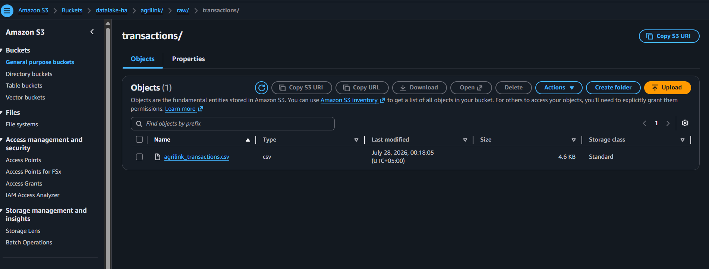
*Shot 1 — the raw CSV landed at `agrilink/raw/transactions/`. The crawler is
pointed at the **folder**, not the file, so future files dropped here join the
same table automatically.*

**2. Create the crawler + its IAM role.**
Glue → Crawlers → Create crawler. Data source = the S3 prefix above,
"crawl all sub-folders". The IAM role was created inline via **Create new IAM
role** (`AWSGlueServiceRole-agrilink`) — this auto-scopes read access to
exactly the chosen prefix and grants Catalog write, i.e. least privilege by
default.

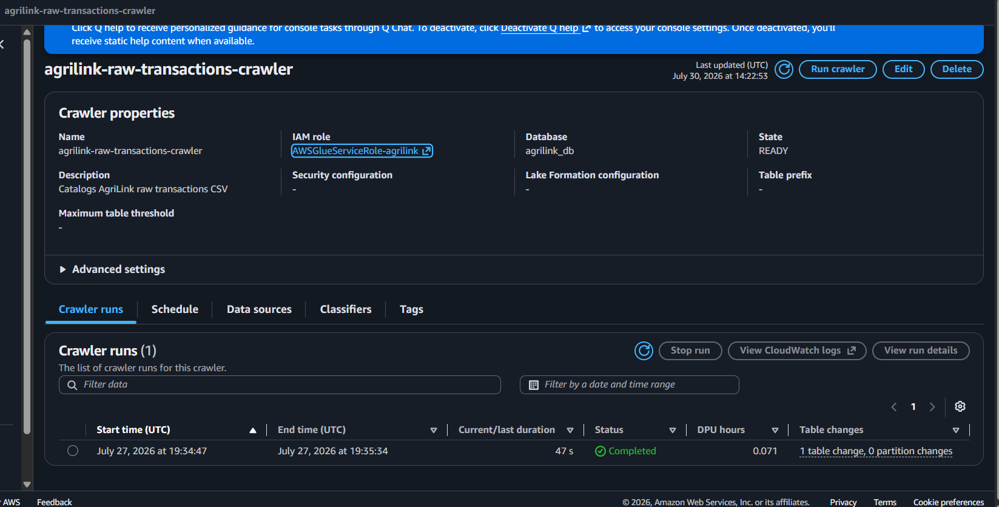
*Shot 2 — the crawler's identity. Note the role is scoped to the one prefix,
not the whole bucket.*
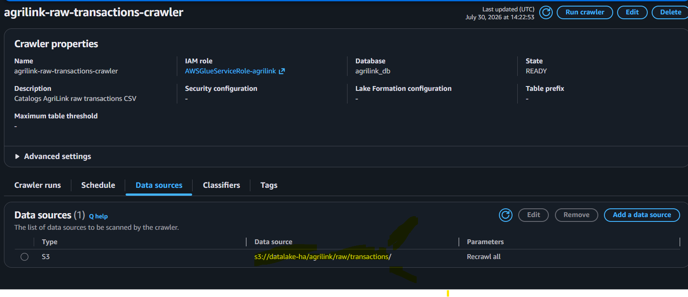


## Proving it worked


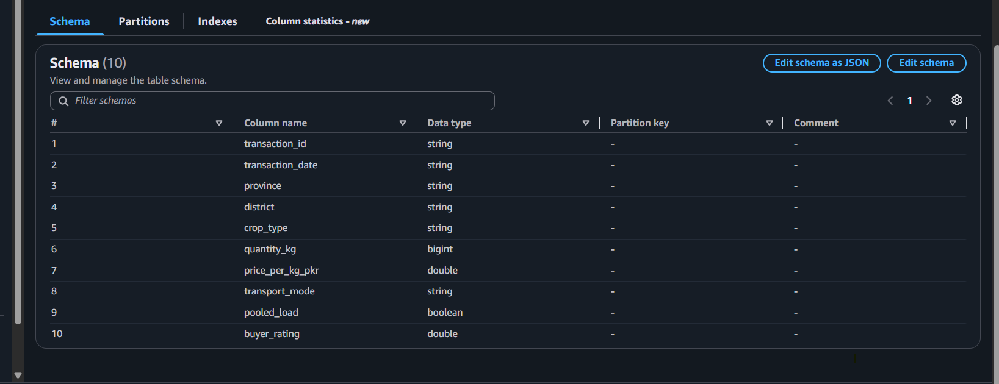
*Shot 3 — the money shot. `agrilink_db.transactions` with every column typed:
`bigint` for `quantity_kg`, `double` for the price/rating, `boolean` for
`pooled_load`, `string` elsewhere. `classification = csv`, `recordCount ≈ 60`.
This single image proves requirements 2 and 4 (schema detected **and**
verified).*

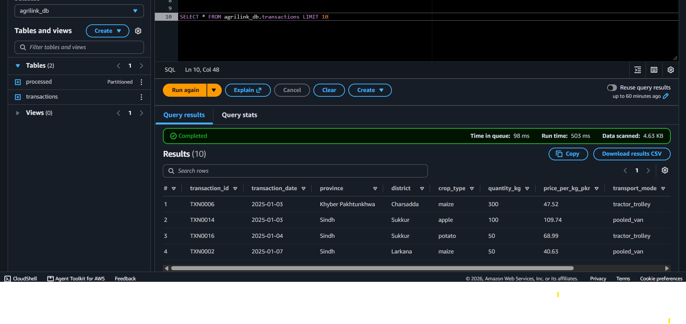
*Shot 4 — `SELECT * FROM agrilink_db.transactions LIMIT 10;` returns real rows.
End-to-end proof that S3 → Crawler → Catalog → Athena is wired correctly.
(Bonus — Athena wasn't required by Task 1, but it's the strongest evidence.)*

| Proof artifact | Requirement satisfied |
|----------------|-----------------------|
| Shot 1 (CSV in S3) | input data in place |
| Shots 2–3 (crawler exists, pointed correctly) | Req 1 — crawler created |
| Shot 3 (Ready, 1 table created) | Req 3 — catalog populated |
| Shot 3 (schema panel) | Req 2 + Req 4 — schema detected & verified |
| Shot 4 (Athena rows) | end-to-end proof (bonus) |

## Design decisions

**Crawler, not a hand-written `CREATE EXTERNAL TABLE`.** Both produce the same
catalog table. The crawler wins here because the schema was *unknown up front*
and new files may arrive over time — it re-discovers on each run. Hand-written
DDL is the better choice only when the schema is fixed and you want it in
version control. For "ingest an unknown raw drop," the crawler is the right
tool, which is exactly what the assignment specifies.

**A dedicated `raw/` layer.** Keeping raw data isolated (the bronze layer of a
medallion layout) means the original is never mutated; every later
transformation writes to a *new* prefix. Reproducibility and rollback come for
free, and Task 2's processed output has a clean place to go
(`.../processed/…`).

**On-demand schedule, not recurring.** The demo file never changes. Real
pipelines schedule the crawler (or trigger it on S3 events) only when data
actually lands — scheduling a static dataset is pure waste.

**Least-privilege IAM + private bucket.** The role reads one prefix and writes
metadata — nothing more. In a *shared* sandbox this matters more, not less; a
broad role is how a one-off credential slip becomes a pattern. Block-all-public
stayed on because the data isn't public.

**Known pitfall, kept as a lesson — the date column.** `transaction_date` was
detected as **`string`, not `date`.** This is expected: CSV carries no type
information, so the crawler samples values and `2025-01-03` is ambiguous to
the classifier. It was **deliberately left as `string`** rather than edited in
the catalog, so that the concept of casting in Athena stays visible. This is
the same class of fragility as the Week 3 `Subtotal`-vs-`Total` regex bug:
inference/pattern-matching is best-effort, and verifying the output is part of
the job, not an afterthought.

## Cost / free-tier notes
- Glue crawler: billed per run by DPU-hour; a single ~2-minute crawl of a
  60-row file is a fraction of a cent.
- Data Catalog: first 1M objects stored + first 1M requests/month are free.
- Athena: billed per data scanned; one `LIMIT 10` over a 5 KB file ≈ **$0**.
- S3 storage at this volume is negligible. **Assignment-scale total ≈ $0.**

---

# Task 2 — Transforming CloudWatch logs with a Glue ETL job, queried by date in Athena

**Status: ✅ complete.**

## What the task asked for

1. Create a **Glue job** to **retrieve CloudWatch logs**.
2. **Process** them for the **`ERROR`** and **`INFO`** tags.
3. **Store** them under the **name tag** (output labelled/partitioned by tag).
4. **Query** the processed data in **Athena by date**.

This is a genuine **ETL** job: **E**xtract from CloudWatch, **T**ransform (split
ERROR/INFO, group by date), **L**oad into S3 as partitioned files — then catalog
and query.

## Architecture (as built)

```
   seed_logs.py  (run in CloudShell -- simulates a real app's logging)
            |
            v
   +------------------------------+
   |   CloudWatch Logs            |   36 events across 3 daily streams,
   |   group: /agrilink/app       |   ~35% ERROR, ~65% INFO, spanning
   |   (INFO / ERROR messages)    |   the last 3 days
   +------------------------------+
            |
            | Glue job retrieves via boto3 (filter_log_events, paginated)
            v
   +------------------------------+        assumes
   |   Glue Python Shell job      |------------------+
   |   agrilink-logs-etl          |                  v
   |   split ERROR / INFO,        |        +-----------------------+
   |   group by (tag, date)       |        | AWSGlueServiceRole-   |
   +------------------------------+        |   logs-etl            |
            |                              | (read CW Logs +       |
            | writes NDJSON, partitioned   |  write S3 processed)  |
            v                              +-----------------------+
   +-------------------------------------------+
   |   Amazon S3 (partitioned output)          |
   |   datalake-ha/logs/processed/             |
   |     tag=error/dt=2026-07-26/events.json   |
   |     tag=error/dt=2026-07-27/events.json   |
   |     tag=info /dt=2026-07-28/events.json   |
   +-------------------------------------------+
            |
            | crawler (same pattern as Task 1)
            v
   +------------------------------+
   |  Glue Data Catalog           |
   |  agrilink_db.processed       |
   |  partition keys: tag, dt     |
   +------------------------------+
            |
            v
   +------------------------------+
   |  Athena:  WHERE dt = '...'   |   <-- the deliverable
   +------------------------------+
```

Two design choices are visible here: the job **retrieves logs directly via the
CloudWatch Logs API** (no separate export-to-S3 step), and the output is
partitioned by **`tag` and `dt`** using Hive-style `key=value` folders — which
is what lets the crawler auto-detect them as partition columns.

## What got created

| Resource | Name | Role |
|---|---|---|
| CloudWatch log group | `/agrilink/app` | Source logs (seeded by `seed_logs.py`) |
| Seed script | `seed_logs.py` | Simulates a real app's logging: 36 events over 3 days |
| Job IAM role | `AWSGlueServiceRole-logs-etl` | Identity the job runs as (read CW Logs + write S3) |
| Glue Python Shell job | `agrilink-logs-etl` | Retrieve → classify → write partitioned NDJSON |
| Job script | `logs_etl_job.py` | The ETL logic |
| Crawler IAM role | `AWSGlueServiceRole-logs` | Identity the crawler runs as (read processed prefix) |
| Glue crawler | `agrilink-logs-processed-crawler` | Catalogs the processed output, detects partitions |
| Glue table | `agrilink_db.processed` | Queryable table with `tag` + `dt` partitions |

## How it was built

**Stage 1 — Seed sample logs into CloudWatch.**
`seed_logs.py`, run in CloudShell, created the `/agrilink/app` log group and
wrote **36 events across 3 daily streams** (today and the two days before). The
severity word (`INFO`/`ERROR`) is embedded in each message text, exactly like
real application logs — that is the field the job classifies on.

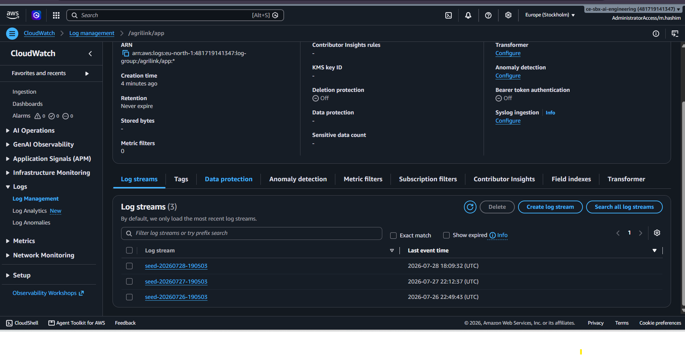
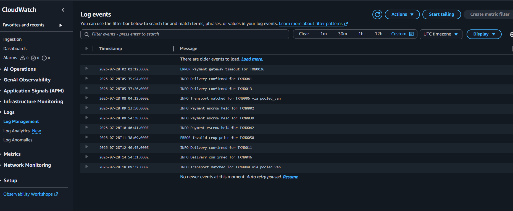

*The `/agrilink/app` group with its daily streams and INFO/ERROR events — the
data the job will retrieve.*

**Stage 2 — IAM role for the job.**
`AWSGlueServiceRole-logs-etl`, with three policies: `AWSGlueServiceRole` (run
the job), `CloudWatchLogsReadOnlyAccess` (read the logs), and an inline
`logs-processed-write` policy (`s3:PutObject` scoped to
`datalake-ha/logs/processed/*`).

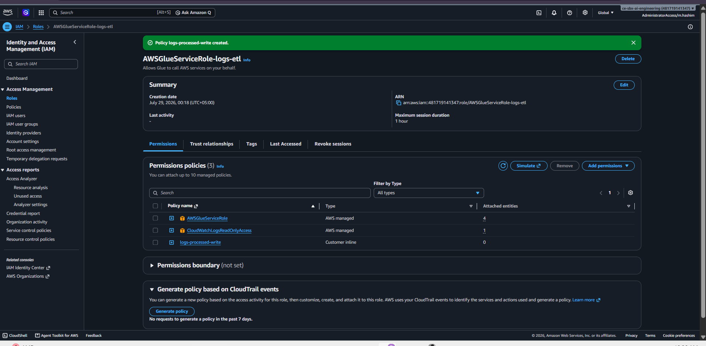
*Least privilege: the job can run, read logs, and write only to the processed
prefix — nothing more.*

**Stage 3 — Create the Glue Python Shell job.**
Glue Studio → **Python Shell script editor** → pasted `logs_etl_job.py`, set
`BUCKET = "datalake-ha"`, selected the role above, Python 3.9, 0.0625 DPU.

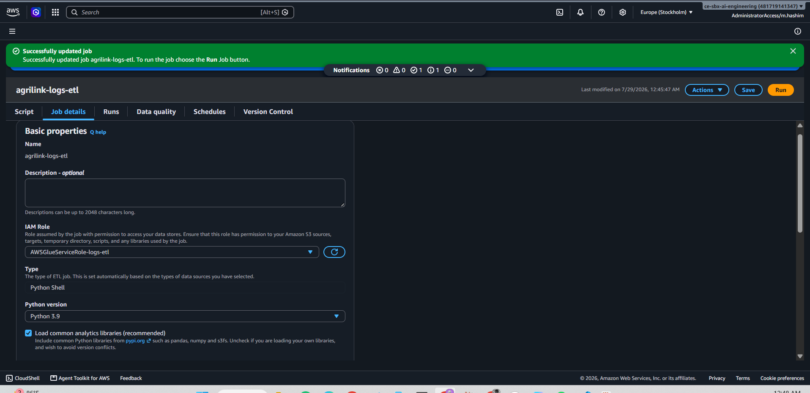
*Python Shell (not Spark) — the right engine for light, single-process string
work.*

**Stage 4 — Run the job.**
The run succeeded; the output log shows the events retrieved and one line per
partition file written.

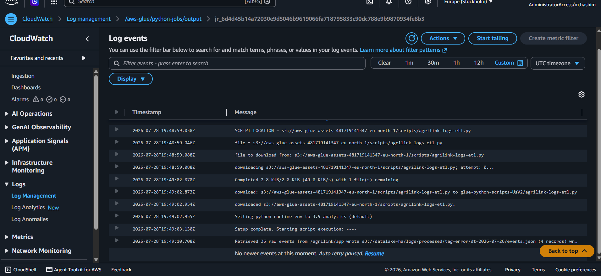
*Run output: `Retrieved N raw events…` and one `wrote s3://…` line per
(tag, date) partition.*

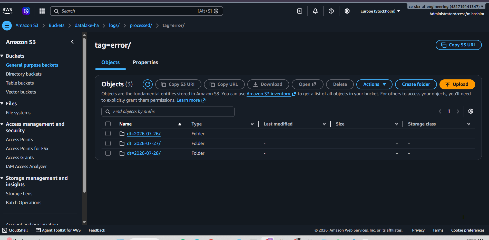
*The Load step's result: `tag=error/` and `tag=info/`, each with
`dt=YYYY-MM-DD/` folders holding `events.json`. This Hive-style layout is the
whole trick.*

**Stage 5 — Catalog the output with a crawler.**
Same pattern as Task 1, pointed at `logs/processed/`. The crawler created its
own role (`AWSGlueServiceRole-logs`) and produced the `processed` table in
`agrilink_db`.

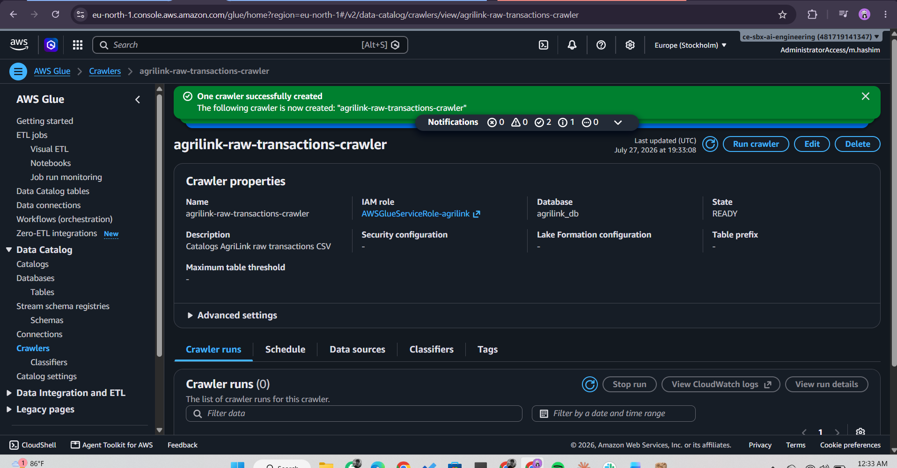
*Crawler pointed at `s3://datalake-ha/logs/processed/`, recrawl all.*

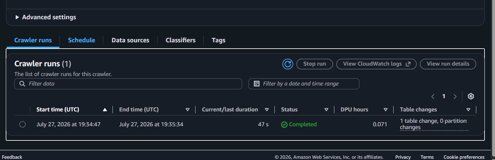
*Ready, 1 table created.*

## Proving it worked

The proof is the table schema showing `tag` and `dt` as **partition columns**,
plus a date-filtered Athena query returning rows.

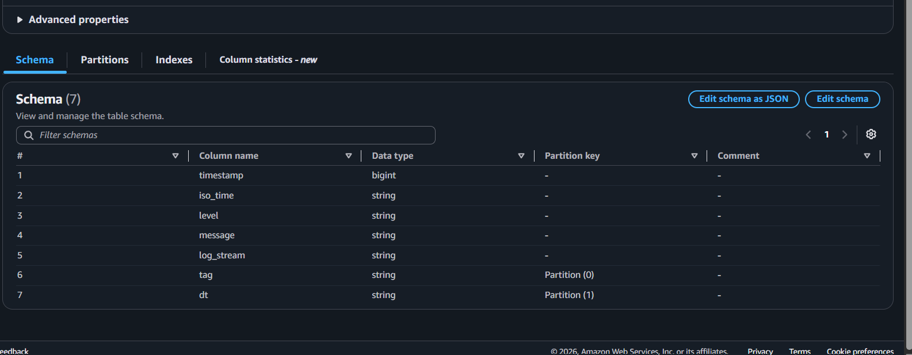
*`agrilink_db.processed`: data columns (`timestamp`, `iso_time`, `level`,
`message`, `log_stream`) **plus** `tag` and `dt` as partition keys — created
from nothing but the S3 folder names.*

Then in Athena (Stage 6), the literal task requirement — query by date:

```sql
-- overview: counts by day and tag (sums to 36)
SELECT dt, tag, count(*) AS events
FROM agrilink_db.processed
GROUP BY dt, tag
ORDER BY dt, tag;
```
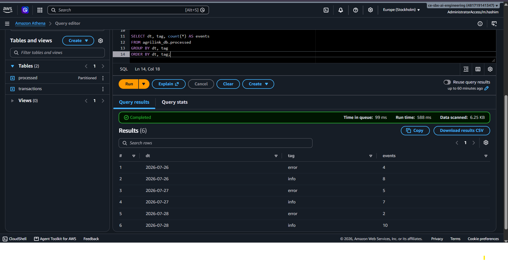
```sql

-- the deliverable: query by date
SELECT iso_time, tag, message
FROM agrilink_db.processed
WHERE dt = '2026-07-27'
ORDER BY iso_time;
```

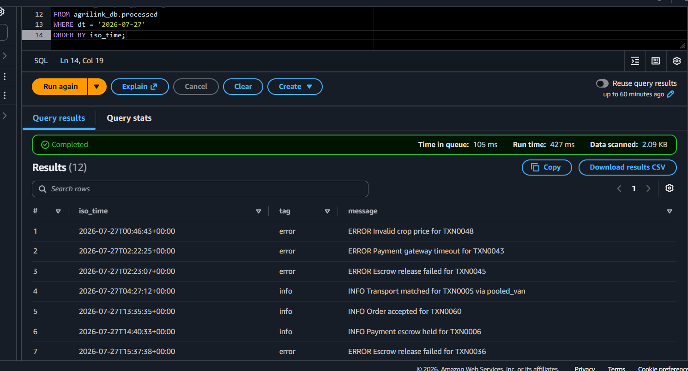
*`WHERE dt = '…'` returns only that day's events. Because `dt` is a partition,
Athena reads just that one folder — the reason the date query is fast and
cheap.*

| Proof artifact | Requirement satisfied |
|---|---|
| `cloudwatchlogs` (seeded logs) | source data exists to retrieve |
| `gluepythonshelljob` + `T2-4_afterjobrun_logs` | Req 1 + 2 — job retrieves & processes |
| `T2-5_s3_bucket_showingfolders` | Req 3 — stored under the tag (partitioned) |
| `table_schema_crawler` (`tag`, `dt` partitions) | processed data is cataloged |
| `athena-query-by-date` | Req 4 — queried in Athena by date |

## Design decisions

**Python Shell, not Spark.** Scanning log lines for `ERROR`/`INFO` is light,
single-process work. Python Shell runs at 0.0625 DPU (1/16) with boto3 built
in; a Spark cluster would be over-provisioned and slower to start. "Which
engine and why" is core ML-Associate material.

**Retrieve directly via the CloudWatch Logs API.** Rather than exporting logs to
S3 first, the job calls `filter_log_events` — paginated with `nextToken`, so no
events are missed regardless of volume. One job, one step, faithful to "create a
Glue job to retrieve CloudWatch logs."

**The tag comes from the message text.** `if "ERROR" in msg` — the severity
lives inside each log line, exactly like real logs. Untagged lines are dropped
(`else: continue`), so the output contains only what was asked for.

**Date derived from each event's own timestamp, not "today."** Events span three
days; filing each under the day it actually occurred is what makes
date-partitioning correct and the Athena date filter meaningful.

**Group by (tag, date), write one file per partition.** Grouping avoids the
thousands-of-tiny-files anti-pattern; each partition gets a single
`events.json`. Output is newline-delimited JSON because that's the
one-record-per-line format Athena's JSON reader expects.

**Hive-style `tag=…/dt=…/` folders.** The load-bearing decision: the crawler
reads the folder *names* and turns `tag` and `dt` into partition columns
automatically, so `WHERE dt = '…'` prunes to a single folder. Partitioning is
what makes "query by date" both possible and cheap (Athena bills by data
scanned).

**Two roles, one per component.** A `-logs-etl` role for the job, a separate
`-logs` role for the crawler. They trust the same service but exist for
different purposes — least privilege per component.


## Orchestration (concept)

Stages 1–6 were run by hand. In production they chain into one pipeline:
**Glue Workflows** is the simplest fit here since every step is Glue (trigger the
ETL job, then the crawler on success). **Step Functions** is the pick when steps
span services (a Lambda, then Glue, then a notification); **EventBridge**
triggers the job when new logs land. Rule of thumb: all-Glue → Glue Workflows;
mixed services → Step Functions; event-driven → EventBridge.

## Cost / free-tier notes
- Glue Python Shell job at 0.0625 DPU for ~1 minute ≈ a fraction of a cent.
- CloudWatch Logs at this volume is negligible / within free tier.
- Crawler + Catalog + Athena: same near-zero as Task 1.
- **Assignment-scale total ≈ $0.**

---

## Why this week matters for the ML Associate cert

Data preparation / feature engineering is one of the largest scored domains on
the AWS ML Associate exam, and the Glue Catalog is the backbone it assumes:
**crawler → Catalog → Athena/Glue ETL → training-ready data in S3.** The mental
models to lock in: crawlers *infer* schema (and can guess wrong on CSV), the
Catalog holds *metadata only*, **partitioning** is the main cost/performance
lever for query-by-key, and **Python Shell vs Spark** is a real
right-sizing decision. All of these recur throughout the exam's data-pipeline
questions.

## Cleanup (shared-account hygiene)

I will Delete in this order when done:
- **Task 2:** the `processed` table, the `agrilink-logs-processed-crawler`, the
  `agrilink-logs-etl` job, the S3 `logs/` objects, the `/agrilink/app` log group,
  and the roles `AWSGlueServiceRole-logs` + `AWSGlueServiceRole-logs-etl`.
- **Task 1:** the `transactions` table, `agrilink_db` database, the
  `agrilink/` S3 objects, the crawler, and `AWSGlueServiceRole-agrilink`.

Delete a role only if you created it and no one else uses it.
