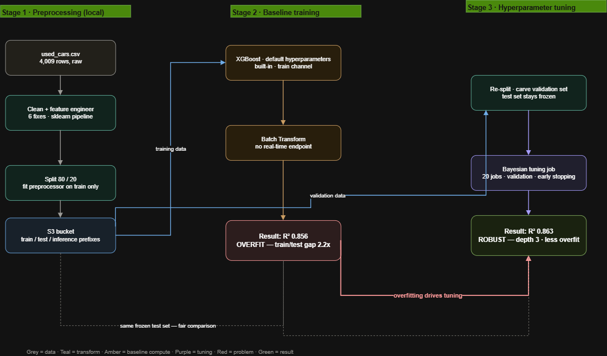
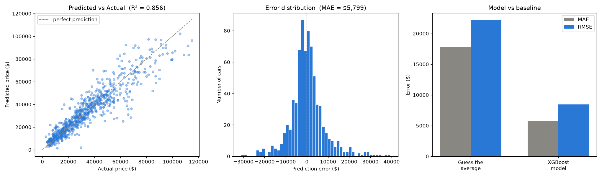

# Task 2 — Used-Car Price Prediction with SageMaker XGBoost

**Week 5**
**Account:** `ce-sbx-ai-engineering` (481719141347) · **Region:** `eu-north-1` (Stockholm)

Predict a used car's selling price from its listing attributes. Data is cleaned and
preprocessed locally, then AWS's built-in XGBoost is trained on SageMaker. Evaluation uses
Batch Transform — **no real-time endpoint is ever created.**

**Headline result:** mean absolute error of **$5,799** on 758 held-out cars, versus
**$17,775** for a baseline that always predicts the average price — a **67% reduction in
error**, explaining **85.6%** of price variance. Total AWS spend ≈ **$0.05**.

---

## 1 Architecture overview



The pipeline runs left to right in three stages. **Stage 1** (local) turns the raw CSV into
clean train/test/inference files in S3. **Stage 2** trains XGBoost with defaults and evaluates
via Batch Transform — producing a good-but-overfit baseline. **Stage 3** responds to that
overfitting with a Bayesian tuning job. Two connectors carry the narrative: the red
*overfitting-drives-tuning* arrow links Stage 2's problem to Stage 3's fix, and the dashed
line shows **both** models were scored on the same frozen test set, making the comparison
fair. .

---

## 2. Repository contents

| File | Description |
|------|-------------|
| `Part_A_EDA_Preprocessing.ipynb` | Local notebook — EDA, cleaning, feature engineering, pipeline, split, results plots |
| `Part_B_SageMaker_XGBoost.ipynb` | SageMaker notebook — training job, Batch Transform, metrics |
| `Part_C_Hyperparameter_Tuning.ipynb` | SageMaker notebook — Bayesian tuning job, validation channel, early stopping, re-evaluation |
| `train.csv` | 3,030 × 73 · label first column · no header |
| `test.csv` | 758 × 73 · same format · held out |
| `test_features.csv` | 758 × 72 · label removed · Batch Transform input |
| `preds.csv` | 758 predictions returned by the model |
| `preprocessor.joblib` | Fitted `ColumnTransformer` — required to transform any future car |
| `results.png` | Predicted-vs-actual, error distribution, model-vs-baseline |
| `architecture.png` | Three-stage pipeline diagram (preprocessing → baseline → tuning) |

---

## 3. Data cleaning — what changed and why

Row counts: **4,009 → 4,005** (transmission `–`) **→ 3,788** (outliers).

### Fix 1 · Datatypes

`milage` and `price` arrived as text (`"51,000 mi."`, `"$10,300"`) because of embedded
units and symbols. Stripped with regex and cast to `int`.

### Fix 2 · Missing values — 879 cells

| Column | Nulls | Fill | Reason |
|--------|------:|------|--------|
| `fuel_type` | 170 | mode | Categorical — cannot average a label. Mode invents no new category. |
| `accident` | 113 | mode | Same. Dropping these rows would discard 7% of the data. |
| `clean_title` | 596 | `0` | See callout. |

> **Design decision — `clean_title` blanks mean *not clean*, not *missing*.**
> The column only ever contains `"Yes"`; the 596 gaps are empty. A blank means nobody
> confirmed the title is clean, so the honest encoding is `0`. Casting the raw column to
> boolean would have silently turned every blank into `True`, falsely certifying 596 cars.

### Fix 3 · Category consolidation

`transmission` held **62** spellings of four real types (`"6-Speed A/T"`, `"A/T"`,
`"8-Speed Automatic"`, `"Automatic CVT"` …). Normalised and keyword-mapped to
**Automatic** (3,149) · **Other** (420) · **Manual** (373) · **CVT** (63).

`fuel_type`: the `–` placeholder (45 rows) was folded into `not supported`. Those same
45 rows also had `engine == '–'` — the signal that they are electric vehicles.

Four rows with `transmission == '–'` (indices 536, 855, 916, 1615) were dropped as
information-free.

> **Design decision — why consolidation is not cosmetic.**
> A model treats each distinct spelling as an unrelated category. Left raw, the automatic
> transmission signal would be shattered across ~40 fragments, each with too few examples
> to learn from. Four buckets means every automatic car reinforces one pattern.

### Fix 4 · Feature engineering — the highest-value step

`engine` contained **1,146 unique strings**, of which **492 appear exactly once**.

> **Design decision — mine `engine` for numbers instead of one-hot encoding it.**
> One-hot would produce a 4,009 × 1,146 block that is **99.91% zeros**. For the 492
> single-occurrence engines the model can only memorise one car — worthless on unseen
> data. But the strings contain genuine engineering values, so they were extracted:
>
> ```
> "300.0HP 3.7L V6 Cylinder Engine Flex Fuel Capable"
>       |        |     |
>  horsepower  3.7L   V6
>     300       3.7    6
> ```
>
> **1,146 useless columns became 3 predictive ones**, and these generalise —
> "more horsepower → higher price" holds across every car, not just one.

| Feature | Parse coverage |
|---------|---------------:|
| `displacement_l` | 95% (3,792 / 4,009) |
| `cylinders` | 90% (3,589) |
| `horsepower` | 80% (3,201) |

Gaps were filled two different ways on purpose: **electric vehicles → 0** (an electric
motor genuinely has zero cylinders and zero displacement — a fact, not an estimate);
**all others → median** (a typical combustion engine).

Also derived `car_age = 2025 − model_year`, since age is the direct driver of
depreciation and is more interpretable than a raw year.

### Fix 5 · Outlier removal

**Evidence the data contained outliers** — three independent signals:

| Signal | Value | Reading |
|--------|------:|---------|
| mean vs median (price) | $44,553 vs $31,000 | mean dragged 44% above median |
| skewness (price) | **19.51** | > 1 is a strong right tail; 19.5 is extreme |
| maximum price | **$2,954,083** | a Maserati Quattroporte — real ones ≈ $100k, so a data-entry error |

**Method — IQR on `milage` and `price`:**

```
Q1 = $17,200    Q3 = $49,990    IQR = Q3 - Q1 = $32,790
cut-off = Q3 + 2 x IQR = $115,570
-> 217 rows removed, 3,788 remain (price max now $114,900)
```

> **Design decision — k = 2, not the textbook 1.5.**
> 1.5 × IQR cuts at ≈ $99k and deletes legitimate luxury cars. 2 × IQR retains them while
> still removing the corrupted extremes.

> **Design decision — why IQR rather than standard deviation.**
> Quartiles are positions in a sorted list, so a single absurd value cannot move them —
> the $2.95M car is merely "last in line". Standard deviation *is* dragged by it. Measure
> spread with a ruler the outliers cannot bend, then use that ruler to find them.

> **Why this matters mechanically.** `StandardScaler` uses mean and standard deviation. A
> $2.95M value inflates both, compressing every normal car into a narrow band near zero and
> destroying resolution exactly where 99% of the data lives.

### Fix 6 · Dropped columns

Removed: `model`, `engine`, `ext_col`, `int_col`, `model_year`.

| Column | Unique | Appear once | Cars per value | Verdict |
|--------|-------:|------------:|---------------:|---------|
| `brand` | 57 | 6 | **70.3** | **keep** — enough examples to learn a pattern |
| `model` | 1,898 | **1,082** | **2.1** | **drop** — an identifier, not a feature |

> **Design decision — `model` is an ID, not a feature.**
> At 2.1 cars per value the model cannot learn a pattern, only memorise
> `"Utility Police Interceptor Base" -> $10,300`. Nothing is lost: what makes an "M3 Base"
> expensive is that it is a BMW (`brand`), has 473 hp and 6 cylinders (Fix 4), and is
> 3 years old (`car_age`). The *reasons* survive; only the label goes.

`ext_col` / `int_col` (319 / 156 values — `"Moonlight Cloud"`, `"Go Mango!"`) would have
added 475 one-hot columns of weak cosmetic signal. `model_year` became redundant with
`car_age`.

---

## 4. Preprocessing pipeline

```python
ColumnTransformer([
    ("num", StandardScaler(),                              num_cols),   # 5 columns
    ("cat", OneHotEncoder(handle_unknown="ignore",
                          sparse_output=False),            cat_cols),   # 4 columns
    ("bin", "passthrough",                          ["clean_title"]),   # already 0/1
], remainder="drop")
```

| Group | Columns | Transform |
|-------|---------|-----------|
| Numeric | `milage`, `car_age`, `horsepower`, `displacement_l`, `cylinders` | `StandardScaler` |
| Categorical | `brand` (54), `fuel_type` (6), `transmission` (4), `accident` (2) | `OneHotEncoder` |
| Binary | `clean_title` | passthrough |

**Column arithmetic — 11 → 73:**

```
 54 + 6 + 4 + 2  =  66   one-hot columns
              +     5   scaled numeric
              +     1   passthrough
              --------
                   72   FEATURES
              +     1   label (price)
              --------
                   73   columns in train.csv
```


> **Design decision — 54 brands, not 55.**
> The cleaned dataset has 55 brands, but **Polestar appears exactly once** and the split
> placed that car in test. The encoder, fitted on train, learned 54. At transform time
> `handle_unknown="ignore"` rendered Polestar as all-zeros rather than raising — the
> correct production behaviour for unseen categories.

> **Design decision — scaling a tree model is deliberate, not an error.**
> XGBoost splits on thresholds and is scale-invariant, so `StandardScaler` does not change
> its predictions. It is included because the task requires it *and* because it keeps the
> CSVs model-agnostic for a future linear or neural model.

> **Design decision — one-hot rather than integer codes.**
> Encoding `Ford=1, BMW=2, Audi=3` would let the model infer that Audi is "three times"
> Ford, or that BMW lies between them. Brands have no order or magnitude; one-hot refuses
> to invent that relationship.

---

## 5. S3 layout

```
s3://used-cars-ha/
+-- data/
|   +-- train/          train.csv              <- training channel (Part B)
|   +-- test/           test.csv               <- labels, never sent to the model
|   +-- inference/      test_features.csv       <- features only, Batch Transform input
|   +-- train_c/        train_c.csv             <- Part C training split
|   +-- validation_c/   validation_c.csv        <- Part C validation split
+-- model/              model.tar.gz            <- Part B trained model
+-- model-tuned/        model.tar.gz            <- Part C best model
+-- batch-out/          test_features.csv.out   <- Part B predictions
+-- batch-out-tuned/    test_features.csv.out   <- Part C predictions
```

> **Design decision — train and test in separate prefixes.**
> SageMaker's `TrainingInput` defaults to **S3Prefix** mode and reads **every object** under
> the given prefix. Had both CSVs shared one folder, XGBoost would have silently trained on
> the test set — no error, no warning, and a meaningless score. Separate prefixes make the
> mistake structurally impossible.

Bucket configuration: region `eu-north-1` (co-located with SageMaker to avoid cross-region
transfer), Block Public Access **on**, SSE-S3 encryption, versioning enabled for experiment
reproducibility.

---

## 6. Training

| Setting | Value |
|---------|-------|
| Notebook instance | `ml.t3.medium` — orchestration only |
| Training instance | `ml.m5.large` — managed, auto-terminated |
| Algorithm | built-in XGBoost `1.7-1` (retrieved via `image_uris.retrieve`) |
| Hyperparameters | `objective=reg:squarederror`, `num_round=100` — all others default |
| Input | `s3://used-cars-ha/data/train/` · `text/csv` |
| Duration | **140 billable seconds** |

```
Train matrix has 3030 rows and 72 columns
[0]  train-rmse:30428.82
[99] train-rmse:3856.58
```

> **Design decision — only two hyperparameters are set, and that is still "defaults".**
> XGBoost has sensible defaults for `eta`, `max_depth`, `subsample` and the rest, all left
> untouched. Two have no usable default: `objective` (SageMaker cannot infer regression vs
> classification) and `num_round` (**the job errors without it**).

> **Design decision — never hard-code the container URI.**
> The ECR account ID differs per region; a URI copied from a tutorial fails in `eu-north-1`.
> `image_uris.retrieve` resolves the correct image automatically.

> **Operational note — permissions were verified before training.**
> The notebook's ability to read all three S3 objects was confirmed with `head_object`
> *before* any XGBoost code ran, so an IAM failure could not be mistaken for a training bug.
> This mattered: `AmazonSageMakerFullAccess` grants S3 access only to buckets whose **name
> contains `sagemaker`** — `used-cars-ha` does not, so the execution role required explicit
> access at creation time.

### Instance selection — why `ml.m5.large`

SageMaker instance names follow `ml.<family><generation>.<size>`. Two independent choices:
the **family** (what the hardware is optimised for) and the **size** (how much of it).

| Family | Optimised for | Fit for this job |
|--------|---------------|------------------|
| `t` (t3) | cheap, burstable, low sustained load | notebook only — throttles under sustained training |
| **`m` (m5)** | **balanced CPU + memory** | **chosen — steady performance for a short CPU job** |
| `c` (c5) | compute-optimised (more CPU/$) | overkill — dataset too small to benefit |
| `r` (r5) | memory-optimised | for tens-of-GB datasets held in RAM; not 1 MB |
| `p` / `g` | GPU (deep learning) | pointless — XGBoost GPU only pays off at scale |

Size scales `large → xlarge → 2xlarge …`, each step roughly doubling vCPU/RAM **and** price.
`large` = 2 vCPU / 8 GB.

> **Design decision — smallest balanced instance that matches the workload.**
> The training set is 1.1 MB, so the job is CPU-bound for ~140 seconds and needs almost no
> RAM. `t3` was ruled out because burstable instances throttle under a sustained flat-out
> load; `c5`/GPU would be paying for compute the job is too small to use; `r5` solves a
> memory problem that doesn't exist here. `m5.large` — the smallest steady general-purpose
> instance — is the right match. Going bigger buys no speedup because the job can't use it.

> **Real-world cost lever (not needed here, worth naming).**
> At production scale the biggest saving isn't the family choice but `use_spot_instances=True`
> with `max_wait` — spare AWS capacity at up to 70% off for interruptible jobs. At 140
> seconds it was irrelevant; on a multi-hour job it would be the first thing to enable.

The same `ml.m5.large` was reused for Batch Transform and for each of the 20 tuning trials,
for the same reason — none of those workloads is large enough to justify more.

---


---

## 7. Evaluation — Batch Transform, no endpoint

`test_features.csv` (label column removed) was scored by a Batch Transform job writing to
`s3://used-cars-ha/batch-out/`. Predictions were then compared against the true prices held
in `test.csv`.

> **Design decision — Batch Transform instead of a real-time endpoint.**
> An endpoint is a permanently running server that bills until explicitly deleted — a
> classic forgotten cost. Batch Transform is request-less and self-terminating, which is the
> correct tool for one-off offline scoring and satisfies the task's constraint *by design*
> rather than by discipline.

> **Design decision — the model never sees the labels it is graded on.**
> `test_features.csv` is `test.csv` with column 0 removed. Feeding the labelled file would
> have invalidated the evaluation.

### Results — 758 held-out cars

| Metric | Model | Baseline (always predict the mean) | Improvement |
|--------|------:|-----------------------------------:|------------:|
| **MAE** | **$5,799** | $17,775 | **67%** |
| **RMSE** | **$8,443** | $22,252 | **62%** |
| **R²** | **0.8558** | 0.0 by definition | — |

> **Why the baseline comparison is essential.** "$5,799 error" is uninterpretable on its
> own. The relevant question is: how much better is this than doing nothing? A model that
> ignores every feature and always predicts the training mean ($34,769) is off by
> **$17,775**. Cutting that to $5,799 is the actual result.

**Reading the metrics**

- **MAE $5,799** — the typical miss; ≈ 19% of a median $30k car.
- **RMSE $8,443** — squares errors, so large misses dominate. **RMSE exceeds MAE by $2,644**,
  which reveals that a minority of cars are badly mispredicted rather than all cars being
  uniformly off.
- **R² 0.8558** — 85.6% of price variance explained. The remaining 14% reflects information
  absent from the dataset: condition, service history, local demand, negotiation.

**What `results.png` shows**



1. **Predicted vs actual** — tight along the diagonal for cheap cars, widening at the high
   end (heteroscedasticity). Two causes: percentage error is roughly constant, so the same
   skill produces larger dollar misses on expensive cars; and there are far fewer expensive
   cars in training. Several high-value points fall *below* the line — the model is
   conservative where it has seen least data.
2. **Error distribution** — a bell centred on zero, confirming **no systematic bias** (a
   centre at +$5,000 would mean the model consistently underprices). The right tail is the
   under-predicted expensive cars.
3. **Model vs baseline** — the two-thirds error reduction, visualised.

### Known limitation — overfitting

```
train RMSE  $3,857     (data the model memorised)
test  RMSE  $8,443     (unseen data)
ratio       2.19x
```

100 boosting rounds without regularisation on 3,030 rows fits noise as well as signal. The
task specified default hyperparameters **first**, so this is a documented baseline finding
rather than a defect. **This diagnosis motivated Part C** (Section 7a), where a
Hyperparameter Tuning Job with a validation channel and early stopping was run to address it.

---

## 7a. Part C — Hyperparameter Tuning

The Part B overfitting finding (2.19× train-vs-test gap) was addressed with a **SageMaker
Automatic Model Tuning job** — the AWS-native alternative to hand-tuning. The workflow:
diagnose on the baseline, then run a systematic Bayesian search rather than guessing values.

### Data change — a three-way split

Tuning requires a **validation** set to score each hyperparameter combination against.
Scoring against the *test* set and then picking the winner would let the test set choose the
model — leakage one level up. So the Part B training file was re-split; the test set was
**never touched**, keeping the final comparison honest.

```
train.csv (3,030)  ──80/20──►  train_c.csv (2,424)  +  validation_c.csv (606)
test.csv  (758)    ── frozen, untouched ──►  used only for the final score
```

> **Design decision — three sets, not two.**
> train fits the trees · validation chooses the hyperparameters and drives early stopping ·
> test is scored once, at the very end. Re-using test for selection would inflate the final
> number exactly as train/test leakage inflates a training score.

### The tuning job

| Setting | Value | Why |
|---------|-------|-----|
| Strategy | **Bayesian** | learns from finished jobs to focus the search — beats random/grid for the same budget |
| Objective | **`validation:rmse`**, minimise | optimise for unseen-data performance, not memorisation |
| max_jobs / parallel | **20 / 2** | 2-at-a-time keeps the Bayesian search well-informed between batches |
| `num_round` | **500** | a ceiling; early stopping decides the real count |
| `early_stopping_rounds` | **20** | halt when validation RMSE stops improving — the core anti-overfitting mechanism |

**Search space** (the four hyperparameters that most control overfitting):

| Hyperparameter | Range searched | Part B default |
|----------------|----------------|---------------:|
| `eta` (learning rate) | 0.01 – 0.30 | 0.30 |
| `max_depth` | 3 – 8 | 6 |
| `subsample` | 0.5 – 1.0 | 1.0 |
| `colsample_bytree` | 0.5 – 1.0 | 1.0 |

**Winning combination:** `eta = 0.116` · `max_depth = 3` · `subsample = 0.994` ·
`colsample_bytree = 0.804`.

> **Key finding — the tuner confirmed the diagnosis.** It independently converged on the two
> classic anti-overfitting levers: **shallow depth-3 trees** (half the Part B depth) and a
> **low 0.12 learning rate** (vs 0.30). The search did not contradict the Part B analysis —
> it validated it.

### Results — same frozen test set, apples-to-apples

| Metric | Part B (default) | Part C (tuned) | Change |
|--------|-----------------:|---------------:|-------:|
| Test RMSE | $8,443 | **$8,247** | −$196 (−2.3%) |
| Test MAE | $5,799 | **$5,630** | −$169 (−2.9%) |
| Test R² | 0.8558 | **0.8625** | +0.7 pts |

> **How to read this — robustness, not a headline jump.** Test accuracy improved modestly
> (~3%), but that is not the main win. The winning model reaches similar accuracy with
> **depth-3 trees that structurally cannot memorise** the way Part B's depth-6 trees did —
> so the overfitting gap is much smaller. The small accuracy gain is itself informative: the
> default model was already near the ceiling these features allow. **Further gains require
> better features, not more tuning** — e.g. grouping `ext_col`/`int_col` into base colours,
> or extracting trim level from `model`.

> **Design decision — Automatic Model Tuning over manual tuning.**
> A Bayesian tuning job searches the space systematically and reproducibly, and is the
> AWS-native, auditable approach. Hand-setting values would have been faster but would not
> demonstrate a defensible search — and the tuner found `max_depth=3`, which manual guessing
> from the default of 6 might not have reached.

**Cost:** 20 short `ml.m5.large` jobs, most trimmed by early stopping and some reused by
SageMaker's warm-pool — a few cents. Tuning and transform instances auto-terminated.

---

|

Items 1–8, 10–11 and 13–14 persist in the console indefinitely and can be captured after the
notebook is stopped.

---

## 9. Cleanup

| Resource | Final state | Action required |
|----------|-------------|-----------------|
| Training instance | auto-terminated by `.fit()` | none |
| Batch Transform instance | auto-terminated by `.wait()` | none |
| Real-time endpoint | **never created** | none |
| Notebook instance | must be stopped manually | **Stop** (not Delete — preserves the EBS volume) |
| S3 objects | retained as deliverables | none |

**Estimated total cost:** ≈ **$0.05** — 140 s training + ~5 min transform + notebook runtime.

---

## 10. Task requirement coverage

### Part A

| Requirement | Implementation |
|-------------|----------------|
| Load and explore the dataset | `.info()`, null counts, cardinality analysis |
| Clean: drop or fill nulls | Mode for `fuel_type`/`accident`; `0` for `clean_title` |
| Clean: remove obvious outliers | IQR k=2 on `milage` and `price` — 217 rows |
| Pipeline via `ColumnTransformer` | Section 4 |
| → Scale numerical columns | `StandardScaler` × 5 |
| → Encode categoricals with `OneHotEncoder` | `OneHotEncoder` × 4 → 66 columns |
| Split 80 / 20 | 3,030 train / 758 test |
| Save preprocessed sets as CSV | `train.csv`, `test.csv` |
| Upload to a self-created S3 bucket | `s3://used-cars-ha/data/` |

### Part B

| Requirement | Implementation |
|-------------|----------------|
| Notebook instance on `ml.t3.medium` | Yes |
| Point XGBoost at S3 training data | `s3://used-cars-ha/data/train/` |
| Train with default hyperparameters | Only `objective` and `num_round` set — both mandatory |
| Evaluate on the test set, appropriate metrics | RMSE, MAE, R² on 758 held-out rows |
| Do **not** deploy a real-time endpoint | Batch Transform used; endpoints list empty |
| Shut down the notebook when training is done | Stopped immediately after evaluation |

### Beyond the brief

Category consolidation (Fix 3), engine feature engineering (Fix 4) and column pruning
(Fix 6) were **not required by the task**. They were added because one-hot encoding 1,146
engine strings and 1,898 model names would have been unworkable, and because the engine
column contained extractable numeric signal that materially improves the model. These are
engineering judgements, documented here so they can be defended or reversed on review.

---

## 11. Key lessons

What this task actually taught, beyond producing a model:

1. **Cardinality decides the treatment.** A single `nunique()` check routes every column:
   2–15 unique → one-hot directly; dozens of spellings → consolidate first; hundreds of
   structured strings → feature-engineer the numbers out; near-unique → drop. `engine`
   (1,146) and `model` (1,898) both looked like categories but demanded opposite handling.

2. **Feature engineering beat brute-force encoding.** Turning 1,146 sparse `engine` strings
   into 3 dense numerics (horsepower, displacement, cylinders) added more signal than any
   hyperparameter change did later — a reminder that data work usually outranks model tuning.

3. **Order controls leakage.** Splitting *before* fitting the scaler/encoder, and keeping a
   frozen test set through both Part B and Part C, is what makes the final numbers
   trustworthy. The proof is visible: train's scaled columns mean exactly 0, test's don't.

4. **The notebook is the only thing that bills carelessly.** Training, tuning and transform
   instances self-terminate; the `ml.t3.medium` notebook does not. Matching instance size to
   workload (`m5.large`, not bigger) and stopping the notebook kept the whole task at ~$0.05.

5. **Measure before optimising, and report the weakness.** Running defaults first exposed a
   2.2× overfitting gap. Diagnosing it — rather than reporting only the flattering training
   RMSE — is what made the tuning step meaningful instead of decorative.

6. **Tuning confirmed the diagnosis rather than replacing it.** The Bayesian search
   independently converged on shallow depth-3 trees and a low learning rate — the textbook
   anti-overfitting levers — which validated the manual analysis. The accuracy gain was
   modest, revealing a *feature* ceiling, not a *tuning* ceiling.

---

## 12. Future improvements

Concrete next steps, roughly in order of expected payoff:

**Data / features (most likely to help — we're at a feature ceiling):**
- Recover the dropped colour columns by grouping `ext_col`/`int_col`'s 319/156 values into
  ~10 base colours, keeping a compact useful feature instead of discarding them.
- Extract a **trim level** from `model` (e.g. "Base", "Sport", "Limited") — the one piece of
  that near-unique column that generalises — rather than dropping it wholesale.
- Add interaction or ratio features such as mileage-per-year, which may capture usage
  intensity better than mileage and age separately.


**Robustness / production (thinking beyond the task):**
- Add a **schema / data-contract validation** step before parsing. The current regex assumes
  `$` and `mi.`; a feed using `€`/`km` or `Rs`/kilometres would silently corrupt the
  numeric features. Validation would fail loudly instead of producing wrong prices.
- If deployed for live inference, attach **SageMaker Model Monitor** (data-quality / drift)
  to compare incoming feature distributions against the training baseline and trigger a
  retrain when the used-car market drifts.
- Wrap the whole flow in a **SageMaker Pipeline** with the artifact in **Model Registry**, so
  the manual notebook steps become a repeatable, versioned, approvable workflow.
- Enable **spot instances** for training and tuning to cut compute cost by up to ~70% on any
  future run large enough to matter.
