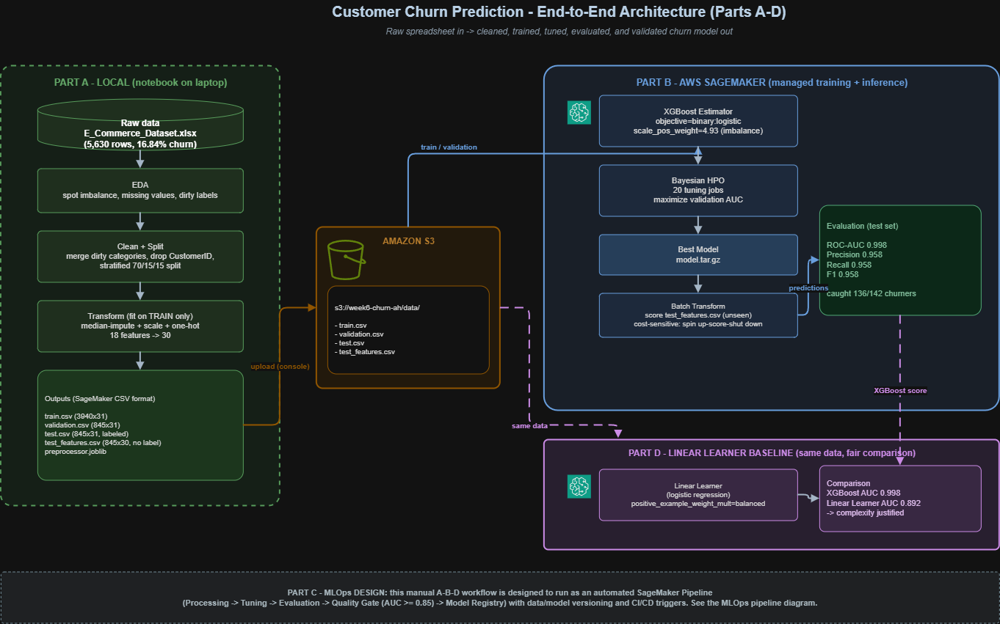
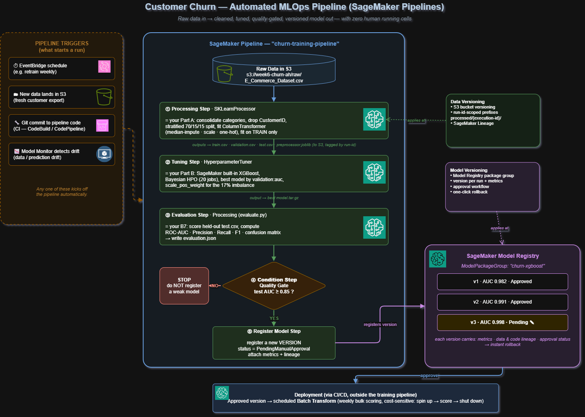
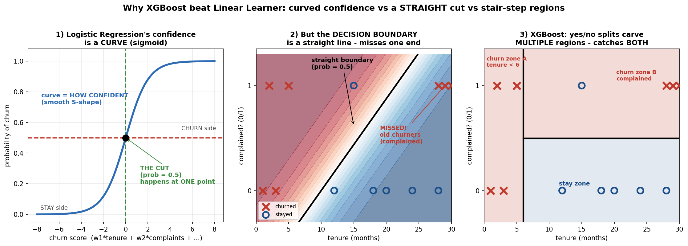

# Customer Churn Prediction — End-to-End ML Pipeline on AWS SageMaker

**Task:** Churn Prediction — Feature Engineering, Model Training, Cost-Sensitive Deployment & MLOps Design
**Stack:** Python · pandas · scikit-learn · AWS S3 · SageMaker (built-in XGBoost, Linear Learner, HPO, Batch Transform)
**Region:** `eu-north-1` (Stockholm) · **Sandbox:** `ce-sbx-ai-engineering` · **Bucket:** `week6-churn-ah`

---

## 1. Overview

An end-to-end machine-learning pipeline that predicts which e-commerce customers are about to churn, so the business can intervene before they leave. The project ingests historical customer data, cleans and engineers features locally, trains a gradient-boosted model on SageMaker with Bayesian hyperparameter tuning, evaluates it honestly on a held-out test set, produces batch predictions cost-efficiently, **validates the model choice against a linear baseline**, and includes a conceptual MLOps design for production automation.

**Headline result:** on 845 unseen customers the tuned XGBoost model caught **136 of 142 real churners (96% recall)** with only **6 false alarms**, at **ROC-AUC 0.998** — and a Linear Learner baseline confirmed the tree model's complexity is justified.

**Parts:**
- **Part A** — Local EDA & preprocessing → 4 model-ready files in S3
- **Part B** — SageMaker XGBoost training, Bayesian HPO, Batch Transform, evaluation
- **Part C** — MLOps pipeline design (diagram + explanation)
- **Part D** — Linear Learner baseline comparison (validating the model choice)

---

## 2. Dataset

| Property | Value |
|---|---|
| Source | E-Commerce Customer Churn (public, Kaggle) |
| Rows | 5,630 customers |
| Columns | 20 (1 ID, 1 target, 18 features) |
| Target | `Churn` (1 = churned, 0 = stayed) |
| Class balance | **16.84% churn** (948 churn / 4,682 stay) — imbalanced |

**Why this dataset :** . I chose an e-commerce churn dataset with the same core properties (a real churn problem, mixed numeric + categorical features, and class imbalance — ~17% here vs ~25% in Telco), but with genuine data-quality challenges to demonstrate handling: **missing values across seven columns** (a real imputation decision) and **duplicate category labels** (the same value written two ways). So it demonstrates the full preprocessing story, not just fit-and-predict on already-clean data.

**Three raw-data problems, each driving a downstream decision:**
1. **Class imbalance (16.84%)** → evaluate on F1 / ROC-AUC / recall, not accuracy.
2. **1,856 missing cells** across 7 numeric columns (~4–5% each) → median imputation.
3. **Dirty categorical labels** (`Phone`/`Mobile Phone`, `CC`/`Credit Card`, `COD`/`Cash on Delivery`, `Mobile`/`Mobile Phone`) → consolidation before encoding.

---

## 3. Architecture



---

## 4. Repository Structure

```
churn-prediction/
|- README.md
|- Part_A_EDA_Preprocessing.ipynb      # local: EDA, cleaning, split, transform, save
|- Part_B_Training_HPO.ipynb           # SageMaker: train, HPO, batch transform, evaluate
|- Part_D_Linear_Learner_Baseline.ipynb# baseline comparison vs XGBoost
|- diagrams/
|   |- Part_C_MLOps_Pipeline.drawio     # the MLOps design diagram
|   |- linear_vs_xgboost.png            # why the tree model wins (decision-boundary visual)
|- data/
|   |- E_Commerce_Dataset.xlsx          # raw input
|- artifacts/                          # produced by Part A, uploaded to S3
    |- train.csv                        # 3,940 x 31  (label first, no header)
    |- validation.csv                   #   845 x 31
    |- test.csv                         #   845 x 31  (labeled, for grading)
    |- test_features.csv                #   845 x 30  (no label, for batch transform)
    |- preprocessor.joblib              # fitted ColumnTransformer

S3 layout (eu-north-1):
  s3://week6-churn-ah/data/{train,validation,test,test_features}.csv
  s3://week6-churn-ah/churn/output/          # XGBoost model artifacts
  s3://week6-churn-ah/churn/batch-output/    # XGBoost predictions
  s3://week6-churn-ah/churn/ll-output/       # Linear Learner artifacts
```

---

## 5. Part A — Feature Engineering & Preprocessing (local)

Pipeline order is deliberate: **load -> inspect -> explore -> decide -> clean -> split -> transform -> save.** The rule connecting the back half is *split before you transform, and learn only from the training data* — the leakage guard.

**Steps:** load the workbook -> inspect (confirm imbalance, missingness, unique `CustomerID`) -> EDA (target, churn-by-category, numeric means, complaints, correlations, missingness) -> **Fix #1** consolidate dirty categories -> **Fix #2** drop `CustomerID` -> **Fix #3** stratified 70/15/15 split -> **Fix #4** preprocessing pipeline (impute + scale + one-hot, fit on train only) -> **Fix #5** save 4 CSVs in SageMaker format + the fitted preprocessor.

**Key design decisions (defensible under cross-examination):**

- **Split before transform.** Imputation/scaling/encoding *learn* values from data. Fitting them on the full dataset leaks validation/test information into training and inflates scores. Splitting first, then fitting on train only, keeps validation and test genuinely unseen.
- **Median imputation** (not mean/KNN/drop). Several columns are skewed with outliers (e.g. `WarehouseToHome` max 127 vs 75th-pct 20); median resists outliers. KNN/MICE are overkill at ~5% missingness; dropping rows discards good data. Learned from train only.
- **One-hot encoding** (not ordinal/target). Categories are nominal, so ordinal would invent a false order; target encoding leaks the label. Low cardinality (<=5) makes one-hot cheap. No `drop_first` because tree models are unaffected by multicollinearity.
- **Scaling even though XGBoost doesn't need it.** Trees are scale-invariant, so scaling doesn't change XGBoost's predictions. Done because the task requires it *and* it makes the processed files reusable for scale-sensitive models — which paid off directly in Part D (the Linear Learner baseline plugged into the same files with zero extra preprocessing).

**Feature count:** 18 features -> **30** after encoding (12 numeric + 17 one-hot + 1 passthrough `Complain`).

> **[INSERT IMAGE: EDA charts — target distribution / churn-by-category / correlation heatmap]**

---

## 6. Part B — Training, HPO, Batch Inference & Evaluation (SageMaker)

**Environment:** SageMaker Notebook Instance (`ml.t3.medium`, kernel `conda_python3`). The notebook only orchestrates; training runs on separate, temporary instances torn down after each job.

**Model:** built-in **XGBoost 1.7-1**, `objective=binary:logistic`, `eval_metric=auc`, `scale_pos_weight=4.93` (train neg/pos ratio, to counter imbalance), `num_round=200` with `early_stopping_rounds=20`.

**HPO:** Bayesian search, **20 jobs**, 3 parallel, maximizing `validation:auc`, over 6 hyperparameters (`max_depth`, `eta`, `min_child_weight`, `subsample`, `colsample_bytree`, `gamma`).

**Deployment:** **Batch Transform** (not a real-time endpoint) — provisions, scores the batch, tears down; pay only for the minutes used. Correct for periodic bulk churn scoring.

**Key design decisions:**
- **`scale_pos_weight`** (not SMOTE/undersampling): makes each churner mistake count ~5x more without fabricating, duplicating, or deleting data.
- **Bayesian HPO** (not grid/random): learns from finished jobs to guess smarter, finding strong configs in fewer, cheaper jobs.
- **Batch Transform** (not endpoint): zero idle cost — a real-time endpoint bills 24/7 (~$150+/month) for latency this use case doesn't need.

### Results (XGBoost)

**HPO:** best **validation AUC 0.9913**; spread across 20 jobs 0.9618–0.9913. Winner: `max_depth=6, eta=0.28, min_child_weight=1, subsample=0.90, colsample_bytree=0.98, gamma=0.23`.

**Test set (845 unseen customers, 142 real churners):**

| Metric | Value | Reading |
|---|---|---|
| ROC-AUC | **0.9976** | Ranks a random churner above a random stayer ~99.8% of the time |
| Precision | **0.9577** | Of those flagged as churn, 96% truly churned |
| Recall | **0.9577** | Of real churners, 96% were caught |
| F1 | **0.9577** | Balanced score |

**Confusion matrix:** TN=697, FP=6, FN=6, TP=136 -> 12 errors in 845 (**98.6% correct**).

> **Why these metrics, not accuracy:** with 16.84% churn, a model predicting "nobody churns" scores 83% accuracy while catching zero churners. Recall answers "how many real churners did we catch?"; precision answers "how much retention budget did we waste on false alarms?"; F1 balances both; ROC-AUC judges the raw probabilities independent of any threshold.

> **Is 0.998 leakage?** No. The dataset is genuinely separable (`Tenure`: churners ~3 mo vs stayers ~11; `Complain`: 31.7% vs 10.9% churn). Leakage would show a train/test gap; instead validation (0.991) and test (0.998) agree — the fingerprint of a truly separable problem. Guards: split before transform, pipeline fit on train only, test set used exactly once.

> **[INSERT IMAGE: HPO leaderboard screenshot + confusion matrix]**

---

## 7. Part C — MLOps Pipeline Design (conceptual)

**Framing:** Parts A and B were run manually, click by click. Part C is the same workflow expressed as an automated, repeatable **SageMaker Pipeline** — raw data goes in one end, and a versioned, quality-gated, registered model comes out the other, with no human running cells.


### The pipeline steps (each = one thing done by hand in Parts A/B)

1. **Processing Step** (`SKLearnProcessor`) — Part A logic: consolidate categories, drop ID, stratified split, fit the `ColumnTransformer` on train only. Outputs train/validation/test CSVs + `preprocessor.joblib`.
2. **Tuning Step** (`HyperparameterTuner`) — Part B logic: built-in XGBoost, Bayesian HPO, best model by `validation:auc`, imbalance weighting. Outputs the winning `model.tar.gz`.
3. **Evaluation Step** (Processing / `evaluate.py`) — Part B7 logic: score held-out test data, compute ROC-AUC / precision / recall / F1 / confusion matrix, write `evaluation.json`.
4. **Condition Step (Quality Gate)** — the heart of MLOps: if test AUC >= 0.85, proceed to register; otherwise STOP and register nothing. This makes automation refuse to promote a weak model.
5. **Register Model Step** — register a new version in the Model Registry, `status = PendingManualApproval`, with metrics + lineage attached.

**Deployment (outside the training pipeline, via CI/CD):** an approved version is deployed to a scheduled **Batch Transform** for weekly bulk scoring — cost-sensitive (spin up -> score -> shut down).

### The three required concepts

**Data Versioning — "which exact data made this model?"** Layered: (1) **S3 bucket versioning** keeps every overwritten file; (2) **run-scoped prefixes** write each run's data to a folder stamped with the execution ID (`processed/{execution-id}/`); (3) **SageMaker Lineage** automatically records the chain *data -> training job -> model*, so "what data made v3?" is a lookup, not detective work. (Alternatives: DVC/LakeFS for Git-style data history; Feature Store for train/serve parity.)

**Model Versioning — keep every model, compare, roll back.** The **SageMaker Model Registry** stores each run's model as a numbered version (v1, v2, v3...) in a package group (`churn-xgboost`), each carrying its metrics, its lineage, and an approval status (`Pending` -> `Approved`/`Rejected`). Only approved versions deploy; rollback to any prior approved version is one click. This replaces the `model_final_v2_really.tar.gz` anti-pattern with a proper catalogue. (Alternative: MLflow Model Registry.)

**Continuous Integration / CD.** Two halves: **CI (code)** — the pipeline definition, `preprocess.py`, and `evaluate.py` live in Git; a commit triggers **CodeBuild** to test the scripts and rebuild the pipeline, so a broken change is caught immediately. **CD / Continuous Training (model)** — a retrain is triggered by an **EventBridge** schedule (e.g. weekly), **new data** landing in S3, or **Model Monitor** detecting drift; the pipeline runs -> quality gate -> registers a version, and a human approval promotes it. The **Quality Gate (Condition Step)** is what makes this automation trustworthy: bad models can't slip through.

**Trigger summary:** EventBridge schedule · new data in S3 · Git commit (CI) · Model Monitor drift.

---

## 8. Part D — Linear Learner Baseline (validating the model choice)

**Purpose:** not to replace XGBoost, but to *prove it was the right choice* by measuring it against a simple, interpretable baseline on identical data. Most projects skip this; measuring model choice rather than assuming it is a mark of rigor.

**Setup:** SageMaker built-in **Linear Learner** in `binary_classifier` mode (= logistic regression), trained on the **exact same S3 files** as XGBoost. Imbalance handled with `positive_example_weight_mult="balanced"` (Linear Learner's equivalent of `scale_pos_weight`). A single training job (no HPO) — a baseline should represent a sensible default, so the fair test is tuned-XGBoost vs sensible-default-linear.

> The Part A scaling (which XGBoost didn't need) is exactly what let the linear baseline plug into the same files with zero extra preprocessing — both models saw identical inputs, so any difference is the algorithm, not the data.

### Comparison (same data, same metrics)

| Metric | XGBoost | Linear Learner | XGBoost wins by |
|---|---|---|---|
| ROC-AUC | 0.9913 | 0.8922 | **+0.099** |
| Precision | 0.9577 | 0.5374 | **+0.420** |
| Recall | 0.9577 | 0.8099 | +0.148 |
| F1 | 0.9577 | 0.6461 | **+0.312** |

*(Both rows are validation-set scores for a like-for-like comparison; XGBoost was additionally confirmed on the untouched test set at AUC 0.9976. Linear Learner's batch output returned NaN scores — a known quirk — so its AUC is taken from SageMaker's training-log validation score; its test-set precision/recall/F1 were computed from the predicted labels.)*

### Why the gap appeared (the key insight)

Churn here is driven by **more than one separate pattern** — very new customers churn, *and* long-tenure customers who complained churn. Those are two different regions of the feature space.

- **Linear Learner (logistic regression)** curves the *confidence* (the sigmoid), but its **decision boundary — where it flips from stay to churn at probability 0.5 — is a straight line.** A single straight boundary can catch one churn group but not both opposite ends, so it over-flags — hence precision of only 0.54.
- **XGBoost (gradient-boosted trees)** carves the space with stacked yes/no splits, so it can isolate "new customers" *and* "complainers" as separate churn regions at once — hence 0.96 on both precision and recall.

The gap is **not** about tuning or number of jobs: tuning changes how well a model fits its shape, not the shape it can fit. A linear boundary is a capability limit, so more jobs wouldn't close a ~0.10 AUC gap.



**Conclusion:** XGBoost's added complexity is **justified** — the churn signal is non-linear, and only the tree model can bend to fit it. Model choice was validated by measurement, not assumption.

---

## 9. Cost Notes

Training cost was negligible — the entire task, including the 20-job HPO, was well under **$1**, because SageMaker bills only while a job runs (each XGBoost job ~1–3 min on `ml.m5.large` at ~$0.115/hr; Batch Transform ~$0.004). The real cost risk is **idle resources**: the notebook instance bills hourly while `InService` (stopped when not in use), and a real-time endpoint would bill 24/7 (~$150+/month) — deliberately avoided by using Batch Transform. Cost-sensitivity was built in via small instances, early stopping, a bounded 20-job search, and ephemeral batch inference.

---

## 10. Future Steps

Natural extensions if this moved toward production:

1. **Threshold optimization.** The 0.5 cutoff is a business lever, not a law. Derive the optimal threshold from a precision-recall curve based on the cost of a missed churner vs a wasted retention offer, rather than defaulting to 0.5.
2. **Build the Part C pipeline for real.** Convert the conceptual design into an actual `sagemaker.workflow` Pipeline with the quality gate and Model Registry, then wrap it in a SageMaker Project for CI/CD.
3. **Drift monitoring + scheduled retraining.** Attach Model Monitor to detect data/prediction drift and trigger EventBridge-scheduled retraining, closing the continuous-training loop.
4. **Feature importance / explainability.** Add SHAP or gain-based importance to explain individual predictions to the retention team and to further evidence that the high AUC is genuine signal (tenure, complaints) rather than leakage.
5. **Tuned-vs-tuned baseline.** For completeness, run HPO on Linear Learner too, to confirm (as expected) that tuning narrows but does not close the capability gap.
6. **Richer feature engineering.** Engineer interaction/ratio features (e.g. coupon-per-order, cashback-per-order) and test whether they lift the linear baseline — a way to probe how much of XGBoost's edge is from automatically-learned interactions.
7. **Try additional algorithms.** LightGBM/CatBoost (faster, native categorical handling) as further tree-based comparisons; a small neural net only if data volume grew substantially.

---

## 11. How to Run

**Part A (local):**
```bash
python -m venv .venv && source .venv/bin/activate
pip install pandas numpy matplotlib seaborn scikit-learn openpyxl jupyter ipykernel
python -m ipykernel install --user --name churn-venv --display-name "Python (churn)"
jupyter lab   # run Part_A_EDA_Preprocessing.ipynb top->bottom
```
Then upload the 4 CSVs to `s3://week6-churn-ah/data/` (AWS Console, `eu-north-1`).

**Parts B & D (SageMaker):** open the notebooks on a notebook instance (kernel `conda_python3`), set `bucket`, run top->bottom. **Stop the notebook instance when done** (it bills hourly while `InService`).

---

*Built as part of the Cloudelligent AI Engineering internship. All jobs run in the shared `eu-north-1` sandbox; costs kept low via small instances, early stopping, bounded HPO, and Batch Transform over a persistent endpoint.*
